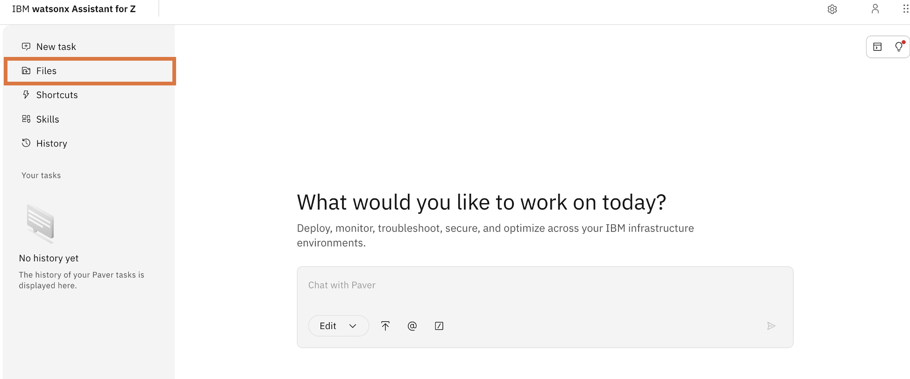
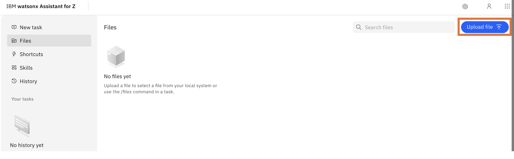
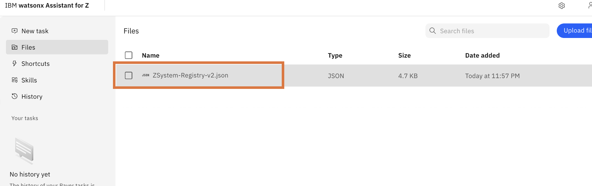
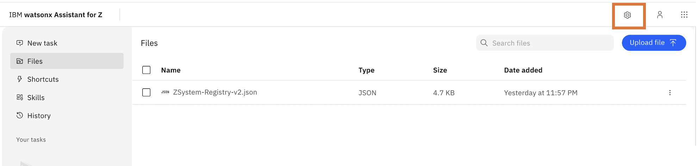
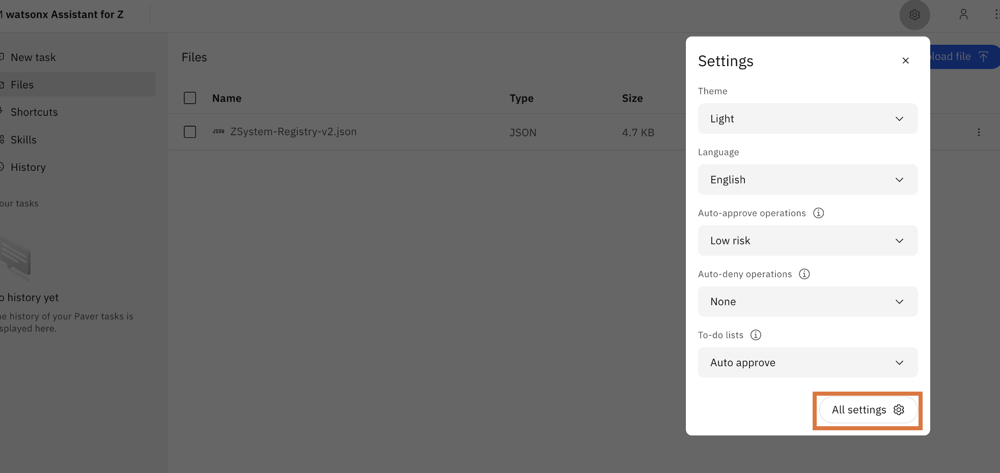
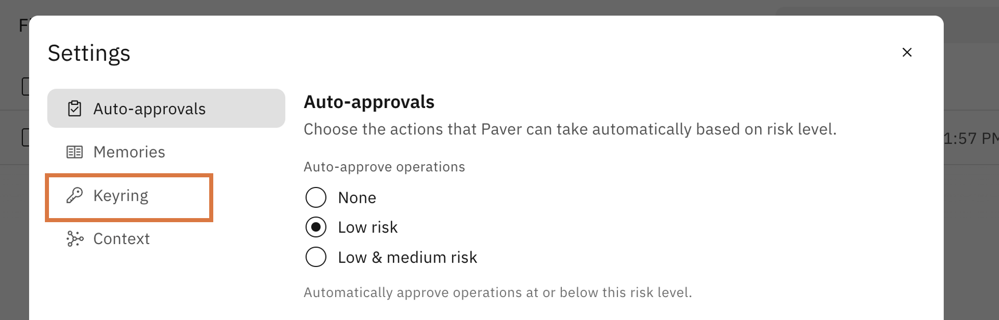
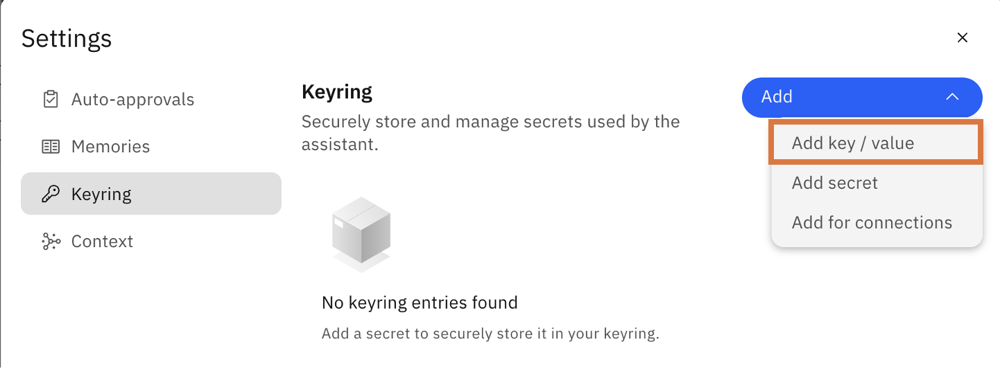
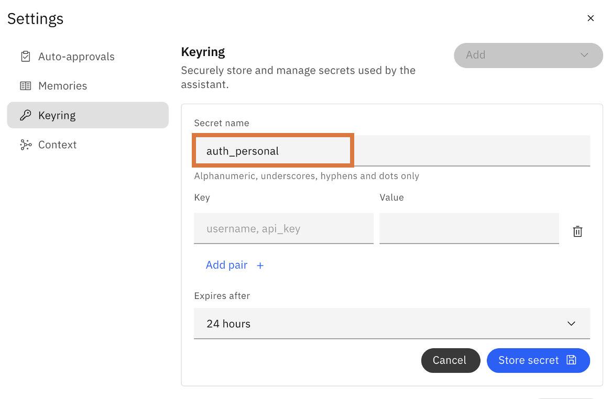
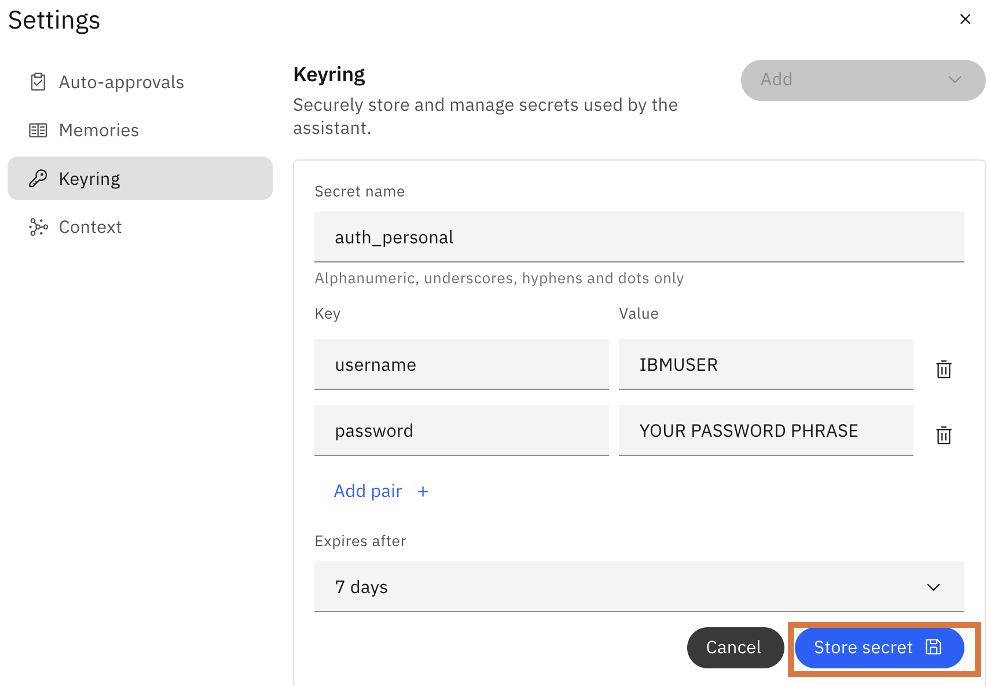
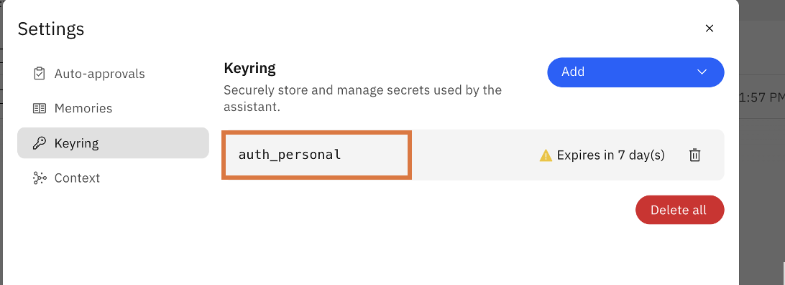

# Configuring local z/OS environment for disruptive skill flows (i.e. `upgrade` and `zos-dump-management` skills)

In order to demonstrate the `software management` and `zos-dump-management` skills, you can setup your own z/OS environment to use as the target for these two skills. This is done via a combination of a custom registry file and user supplied keyrings.

## Provision dedicated z/OS environment

1. Provision a demo environment (i.e. zD&T) from TechZone **<a href="https://techzone.ibm.com/my/reservations/create/69c99ef33dc0863bd858581c" target="_blank">here</a>**


2. Once the environment is ready, follow the steps here to **<a href="https://ibm.github.io/wxa4z-L4-Agentic/techzone/zdt/#accessing-the-environment" target="_blank">Access your environment</a>** and **<a href="https://ibm.github.io/wxa4z-L4-Agentic/techzone/zdt/#set-new-passphrase-for-ibmuser" target="_blank">set a new passphrase</a>** for the default **IBMUSER** user ID ***(you will need this password value later for executing the skills)***. 
   - Record the passphrase value you used in the steps referenced above

3. Next, you will need to generate a **transfer id** and **password** for the purpose of the support-skill. 

    a) Navigate to the **<a href="https://www.ecurep.ibm.com/transferids/" target="_blank">IBM Support File Transfer ID Management</a>** page.
    
    b) Click **Generate a new transfer ID**

    c) After generating, a window will appear showing your Transfer ID and Password. *Ensure you record the value of both - you won't be able to view afterwareds*. 

4. Ensure you have the following information ready and then navigate back to the Preview UI environment:

   - **Public IP** of your zD&T environment
   - **Passphrase** value you set for the default IBMUSER ID
   - **Transfer ID and password** values generated previously

## Configuring local registry

For the purpose of executing the `upgrade` PTF management and `dump` management skills on a live z/OS system, you will configure an alternative registry file containing the connection details to your dedicated environment. 

As opposed to the other skills which use the **`ZSystem-Registry-v2.json`** file provided within the installed plugin itself, the `upgrade` and `dump` related skills are configured to look for your local registry file that you will customize and upload directly to the wxa4z chat. 

1. First, you will need to create the sample **ZSystem-Registry-v2.json** file locally which you will then customize.

   **Expand and copy the following JSON snippet** and paste into a text editor of your choice (i.e. VS Code), and save the file locally as `ZSystem-Registry-v2.json`.

   <details markdown="1">
   <summary><strong>ZSystem-Registry-v2.json</strong>: click to expand full JSON</summary>

   ```jsonc
   {
     "documentType": "ibm-z-service-endpoint-registry",
     "schemaVersion": "2.1",
     "registryId": "registry.ibm-z.prod",
     "environment": "PROD",
     "lastUpdated": "2026-10-26T18:48:04.754Z",
     "defaults": {
       "connectTimeoutMs": 10000,
       "requestTimeoutMs": 60000,
       "verifyTls": true
     },
     "records": [
       {
         "id": "zos.personal",
         "type": "component",
         "kind": "zos-system",
         "name": "zos-personal",
         "description": "z/OS system PLPSC managed by its own z/OSMF environment.",
         "parent": null,
         "child": [
           "service.zosmf.personal",
           "service.support.personal"
         ],
         "properties": {
           "sysplexName": "AQFTPLEX",
           "systemName": "VS01_003"
         }
       },
       {
         "id": "auth.basic.personal",
         "type": "auth-profile",
         "kind": "basic",
         "name": "PLPSC userid/password identity",
         "description": "Credential reference for PLPSC z/OSMF; no secret material stored in this registry.",
         "parent": null,
         "child": null,
         "properties": {
           "credentialKey": "auth_personal"
         }
       },
       {
         "id": "service.zosmf.personal",
         "type": "service",
         "kind": "zosmf",
         "name": "z/OSMF on PLPSC",
         "description": "z/OSMF environment for PLPSC managing z/OS system AQFT.",
         "parent": [
           "zos.personal"
         ],
         "child": [
           "endpoint.zosmf.personal.softwaremanagement"
         ],
         "properties": {
           "host": "<hostIP>",
           "port": <hostPort>,
           "servesComponentRefs": [
             "zos.personal"
           ]
         }
       },
       {
         "id": "endpoint.zosmf.personal.softwaremanagement",
         "type": "endpoint",
         "kind": "zosmf",
         "name": "Manages software instances on PLPSC",
         "description": "Software Instance Management via z/OSMF on PLPSC.",
         "parent": [
           "service.zosmf.personal"
         ],
         "child": null,
         "properties": {
           "JCL_ACCOUNT": "ACCT001",
           "JCL_CLASS": "A",
           "JCL_MSGCLASS": "H",
           "JCL_PATH": "//SMPNTS DD PATH='/u/ibmuser/tmp/smpe',PATHDISP=KEEP\n//SMPCPATH DD PATH='/usr/lpp/smp/classes/'",
           "PDS_NAME": "IBMUSER.REXX",
           "vendorConfigs": {
             "IBM": {
               "clientConfig": "<CLIENT\n  downloadmethod=\"https\"\n  downloadkeyring=\"*AUTH*/*\"\n  javahome=\"/usr/lpp/java/java21/J21.0_64/\"\n  classpath=\"/usr/lpp/smp/classes/\"\n signaturekeyring=\"*AUTH*/*\" >\n</CLIENT>",
               "orderServerConfig": "<ORDERSERVER\n   url=\"https://eccgw01.boulder.ibm.com/services/projects/ecc/ws/\"\n   keyring=\"IBMUSER/SMPERING\"\n   certificate=\"SMPE Client Certificate\" >\n</ORDERSERVER>"
             },
             "ThirdParty": {
               "clientConfig": "<CLIENT\n  downloadmethod=\"https\"\n  downloadkeyring=\"*AUTH*/*\"\n  javahome=\"/usr/lpp/java/java21/J21.0_64/\"\n  classpath=\"/usr/lpp/smp/classes/\"\n signaturekeyring=\"*AUTH*/*\" >\n</CLIENT>",
               "orderServerConfig": "<ORDERSERVER\n   url=\"https://eccgw01.boulder.ibm.com/services/projects/ecc/ws/\"\n   keyring=\"IBMUSER/SMPERING\"\n   certificate=\"SMPE Client Certificate\" >\n</ORDERSERVER>"
             }
           },
           "authRef": "auth.basic.personal",
           "capability": "softwaremanagement",
           "enabled": true,
           "host": "<hostIP>",
           "isVerifySSL": false,
           "method": "GET",
           "path": "/zosmf/swmgmt",
           "port": <hostPort>,
           "priority": 100,
           "protocol": "HTTPS",
           "serviceRef": "service.zosmf.personal",
           "targetComponentRefs": [
             "zos.personal"
           ]
         }
       },
       {
         "id": "service.support.personal",
         "type": "service",
         "kind": "support",
         "name": "service-support",
         "description": null,
         "parent": [
           "zos.personal"
         ],
         "child": [
           "endpoint.support.personal"
         ],
         "properties": null
       },
       {
         "id": "endpoint.support.personal",
         "type": "endpoint",
         "kind": "support",
         "name": "personal support endpoint",
         "description": null,
         "parent": [
           "service.support.personal"
         ],
         "child": null,
         "properties": {
           "capability": "support",
           "protocol": "HTTPS",
           "host": "<hostIP>",
           "port": <hostPort>,
           "path": "/zosmf",
           "serviceRef": "service.support.personal",
           "targetComponentRefs": [
             "zos.personal"
           ],
           "authRef": "auth.basic.personal",
           "enabled": true,
           "transferId": "<transfer_id>",
           "transferKey": "<transfer_pw>",
           "priority": 100,
           "url": "https://<hostIP>:<hostPort>/zosmf",
           "sysName": "VS01",
           "verifyTls": false,
           "isVerifySSL": false
         }
       }
     ]
   }
   ```

   </details>

2. Once copied and saved locally, you will need to customize the sections outlined below. For full details on configuring the registry file, review the official IBM Docs page...

   Locate the section within the JSON beginning with `service.zosmf.personal`, as shown below:

   <details markdown="1">
   <summary><strong>service.zosmf.personal</strong>: click to expand full JSON</summary>

   `````jsonc
   {
     "id": "service.zosmf.personal",
     "type": "service",
     "kind": "zosmf",
     "name": "z/OSMF on PLPSC",
     "description": "z/OSMF environment for PLPSC managing z/OS system AQFT.",
     "parent": [
       "zos.personal"
     ],
     "child": [
       "endpoint.zosmf.personal.softwaremanagement"
     ],
     "properties": {
       "host": "<hostIP>",
       "port": <hostPort>,
       "servesComponentRefs": [
         "zos.personal"
       ]
     }
   },
   `````

   </details>

   In the above snippet, replace `<hostIP>` and `<hostPort>` with the **Public IP** of your **zD&T environment** you provisioned previously and the corresponding **z/OSMF port** (`10443` if using zD&T):


3. Next, locate the section beginning with `endpoint.zosmf.personal.softwaremanagement` as shown below:

   <details markdown="1">
   <summary><strong>endpoint.zosmf.personal.softwaremanagement section</strong>: click to expand full JSON</summary>

   ```jsonc
   {
     "id": "endpoint.zosmf.personal.softwaremanagement",
     "type": "endpoint",
     "kind": "zosmf",
     "name": "Manages software instances on PLPSC",
     "description": "Software Instance Management via z/OSMF on PLPSC.",
     "parent": [
       "service.zosmf.personal"
     ],
     "child": null,
     "properties": {
       "JCL_ACCOUNT": "ACCT001",
       "JCL_CLASS": "A",
       "JCL_MSGCLASS": "H",
       "JCL_PATH": "//SMPNTS DD PATH='/u/ibmuser/tmp/smpe',PATHDISP=KEEP\n//SMPCPATH DD PATH='/usr/lpp/smp/classes/'",
       "PDS_NAME": "IBMUSER.REXX",
       "vendorConfigs": {
         "IBM": {
           "clientConfig": "<CLIENT\n  downloadmethod=\"https\"\n  downloadkeyring=\"*AUTH*/*\"\n  javahome=\"/usr/lpp/java/java21/J21.0_64/\"\n  classpath=\"/usr/lpp/smp/classes/\"\n signaturekeyring=\"*AUTH*/*\" >\n</CLIENT>",
           "orderServerConfig": "<ORDERSERVER\n   url=\"https://eccgw01.boulder.ibm.com/services/projects/ecc/ws/\"\n   keyring=\"IBMUSER/SMPERING\"\n   certificate=\"SMPE Client Certificate\" >\n</ORDERSERVER>"
         },
         "ThirdParty": {
           "clientConfig": "<CLIENT\n  downloadmethod=\"https\"\n  downloadkeyring=\"*AUTH*/*\"\n  javahome=\"/usr/lpp/java/java21/J21.0_64/\"\n  classpath=\"/usr/lpp/smp/classes/\"\n signaturekeyring=\"*AUTH*/*\" >\n</CLIENT>",
           "orderServerConfig": "<ORDERSERVER\n   url=\"https://eccgw01.boulder.ibm.com/services/projects/ecc/ws/\"\n   keyring=\"IBMUSER/SMPERING\"\n   certificate=\"SMPE Client Certificate\" >\n</ORDERSERVER>"
         }
       },
       "authRef": "auth.basic.personal",
       "capability": "softwaremanagement",
       "enabled": true,
       "host": "<hostIP>",
       "isVerifySSL": false,
       "method": "GET",
       "path": "/zosmf/swmgmt",
       "port": <hostPort>,
       "priority": 100,
       "protocol": "HTTPS",
       "serviceRef": "service.zosmf.personal",
       "targetComponentRefs": [
         "zos.personal"
       ]
     }
   },
   ```

   </details>

   At a mimimum, and if using the **zD&T TechZone environment** referenced earlier, you will only need to modify the following lines from the above snippet to point to your own `<hostIP>` and `<hostPort>`:

   ```
   "host": "<hostIP>",
   "isVerifySSL": false,
   "method": "GET",
   "path": "/zosmf/swmgmt",
   "port": <hostPort>,
   ```
   
   If you're using a different environment, there would be many other parameters to modify, such as the JCL and ClientConfig values. If using the **zD&T environment**, you can leave the defaults.


4. Finally, locate the section of the JSON beginning with `endpoint.support.personal` as shown below:

   <details markdown="1">
   <summary><strong>endpoint.support.personal section</strong>: click to expand full JSON</summary>

   ```jsonc
   {
     "id": "endpoint.support.personal",
     "type": "endpoint",
     "kind": "support",
     "name": "personal support endpoint",
     "description": null,
     "parent": [
       "service.support.personal"
     ],
     "child": null,
     "properties": {
       "capability": "support",
       "protocol": "HTTPS",
       "host": "<hostIP>",
       "port": <hostPort>,
       "path": "/zosmf",
       "serviceRef": "service.support.personal",
       "targetComponentRefs": [
         "zos.personal"
       ],
       "authRef": "auth.basic.personal",
       "enabled": true,
       "transferId": "<transfer_id>",
       "transferKey": "<transfer_pw>",
       "priority": 100,
       "url": "https://<hostIP>:<hostPort>/zosmf",
       "sysName": "VS01",
       "verifyTls": false,
       "isVerifySSL": false
     }
   }
   ```

   </details>
   
   In the `properties` section, modify the following parameters which are retrieved when performing dump operations:

    - `"host": "<hostIP>",`
      - replace `<hostIP>` with the Public IP of your environment
    - `"port": <hostPort>,`
      - replace `<hostPort>` with `10443` if using the **zD&T environment**
    - `"transferId": "<transfer_id>",`
      - replace `<transfer_id>` with the value of your unique **Transfer ID** that you generated previously
    - `"transferKey": "<transfer_pw>",`
      - replace `<transfer_pw>` with the value of your unique **Transfer password** that you generated previously
    - `"url": "https://<hostIP>:<hostPort>/zosmf",`
      - Replace the `<hostIP>` and `<hostPort>` values similarly as above


5. Once fully customized and saved locally, upload your modified registry file to your Chat session by clicking on the **`Files`** left-hand menu option:
   
    


6. Then click **Upload file** and select the file you customized and saved. 
   
    

7. Once done, you should see your registry file added as shown below:
   
    


## Create `auth_personal` keyring

The above steps are used to configure endpoint communication to your dedicated z/OS environment, including other details such as transfer file management. In addition to the values you modified, the registry is configured with an `auth-profile` that expects a user's keyring to be created and exported to the conversation. 

As defined in the `ZSystem-Registry-v2.json` file you customized, the name of this keyring should be `auth_personal` which contains the `username` and `password` keys. 

1. In the Chat view of the UI, navigate to **Settings** by clicking on the gear icon at the top-right of the page:
   
    


2. From there, click on **All settings**.
   
    


3. Next click on the **Keyring** menu option in the pop-up window:
   
    


4. Click on `Add` and then in the drop-down, select `Add key / value`:
   
    


5. In the `Secret name` field, enter **`auth_personal`**.
   
    


6. Then enter the following key-value pairs:
   
    **NOTE: you may have to click `Add pair +`**

    - `Key`: **`username`**
    - `Value`: **`IBMUSER`**
    <br>

    - `Key`: **`password`**
    - `Value`: *Enter the unique password phrase you you previously set for the default `IBMUSER` ID*

    It should look similar to what's shown below:

    


    **NOTE: set the `Expires after` option to any amount of time you expect to use the environment**

7. Finally, click **Store secret** at the bottom.
   
    After saving, you should see your keyring entry listed similarly to what's shown below:

    

