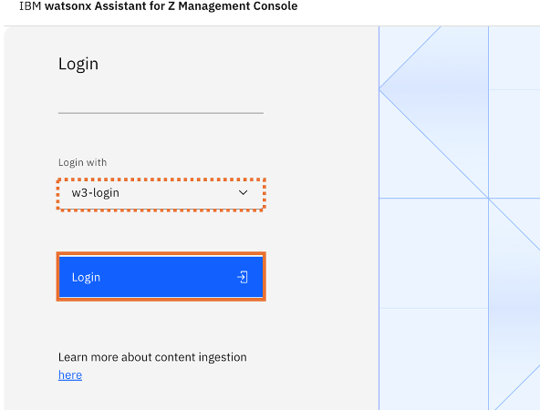
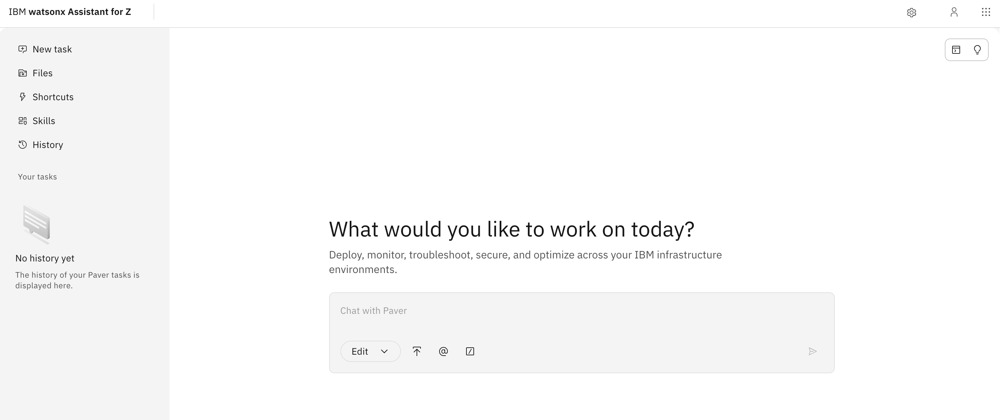
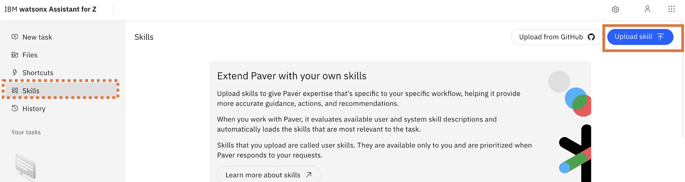
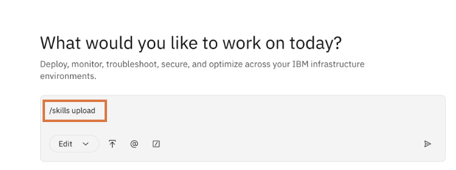

# Setup & Configuration

## Logging into the UI (test)

1. Navigate to the environment UI and authenticate using the `w3-login` option:
   
   **Demo URL:** [https://52.118.249.172:6443](https://52.118.249.172:6443)

     
    
   
3. Once logged in, you'll be redirected to the `Chat Assistant` page a shown below:
   
   
   


The `z-expertise-domain-skills` plugin is pre-installed and consists of the following set of skills:

- `z-incident-investigator`
- `z-transaction-and-messaging-operations​`
- `z-database-operations​`
- `z-performance-capacity-and-cost​`
- `z-system-operations​`
- `z-change-configuration-and-maintenance​`
- `z-job-and-scheduling-operations​`
- `z-knowledge-and-documentation​`
- `ztpf-ei-report-analysis​`


Depending on the query, one or many of the above skills may be invoked to interact with the various connection endpoints. Below provides a summary of each skill category and the target personas.


**Skill Name** | **Skill Category** | **Description** | **Personas**
--- | --- | --- | --- 
`z-knowledge-and-documentation` | Enterprise Knowledge & Guidance | Access enterprise operational knowledge through natural-language interactions to investigate issues, understand procedures, retrieve information, and perform supported actions across connected systems and data sources. Quickly gain trusted insights into messages, abends, commands, architecture concepts, product documentation, known issues, fixes, and recommended actions. | All personas 
`z-incident-investigator` | Incident Analysis & Root Cause Investigation​ | Correlate alerts, events, incidents, changes, and dependencies across systems to accelerate diagnosis and identify probable causes of service disruptions.​ | Incident Managers, Operations​
`z-performance-capacity-and-cost` | Performance, Capacity & Cost Management​​ | Monitor CPU, zIIP, WLM, CICS, storage, network, and workload utilization to identify performance bottlenecks, capacity risks, and software cost drivers.​​ | Performance Analysts, Capacity Planners​
`z-job-and-scheduling-operations` | Batch Operations & Scheduling​​ | Analyze delayed, stalled, or failed batch workloads by examining schedules, dependencies, resources, critical paths, job execution, and completion status.​​ | Operations Teams​
`z-system-operations` | System Operations & Recovery​​​ | Investigate system health, automation status, started tasks, console activity, IPL readiness, dumps, and recovery procedures to resolve operational issues faster. | Operators, System Programmers​
`z-database-operations` | Database Operations & Availability​​​​ | Investigate Db2 and IMS health, availability, contention, locks, utilities, configuration settings, and performance issues impacting database services.​ | DBAs, System Programmers​
`z-transaction-and-messaging-operations` | Transaction and Messaging Runtime Diagnostics​ | Troubleshoot CICS, IMS, MQ and Java environments by tracing transactions, runtime resources, dependencies, and application failures.​ | Application Support Teams​
`z-change-configuration-and-maintenance​` | Software Maintenance & Currency​| Identify missing HIPER, PE, APAR, and FIXCAT updates, review software inventory, and maintain visibility into system maintenance requirements.​​ | System Programmers
`ztpf-ei-report-analysis​` | z/TPF EI Report Analysis​​​​​ | Analyze the z/TPF system workload distribution and application activity shown in an uploaded EI report from the z/TPF software profiler.​​ | z/TPF Engineers​


## Additional Config for `dump` and `zos-mgmt` skills

For disruptive operations such as **z/OS Dump Management** and **Software Management**, there are additional setup steps needed to configure your own environment to demonstrate these skills. If demoing these skills, ensure you complete the [following section](./config-auth-personal.md).

## Importing/testing Custom Skills

Additionally, users can import their own custom skills that remain isolated from other users' shells and can be used for testing. This can be done by:

   a. Clicking on the `Skills` menu tab and selecting **Upload skill**:

   
   


   b. Typing `/skills upload` within the Chat

   
   


### Create your own skills with IBM Bob

IBM Bob is a great place to start in creating new custom skills, or translating existing custom agents to new custom skills for V4. 

Leverage the `skill-creator` skills within Bob to provide this capability: https://internal.paver.ibm.com/docs/skills/writing

For example, after opening the Bob IDE:

1. Create a `~/.bob` directory in your home directory.


2. Run the following command to install the `skill-creator` skill in your workspace (or globally):
   
    ```
    npx skills add anthropics/skills@skill-creator --agent bob --copy --global
    ```
   
3. Start the Bob IDE. Bob will load the `skill-creator` globally installed on `~/.bob/skills` and will use it for your task.


4. Enter a prompt to create the first draft of your Paver skill. 
   
    For example, 

    ```
    Use the `skill-creator` skill, , the Paver skill template /templates/SKILL.md, and the Paver skill guidance /templates/template-usage-guidelines.md to help me build a skill for tagging resources in IBM Cloud.

    The design for this new skill is in the <path-to-your-design-document> file.
    ```
