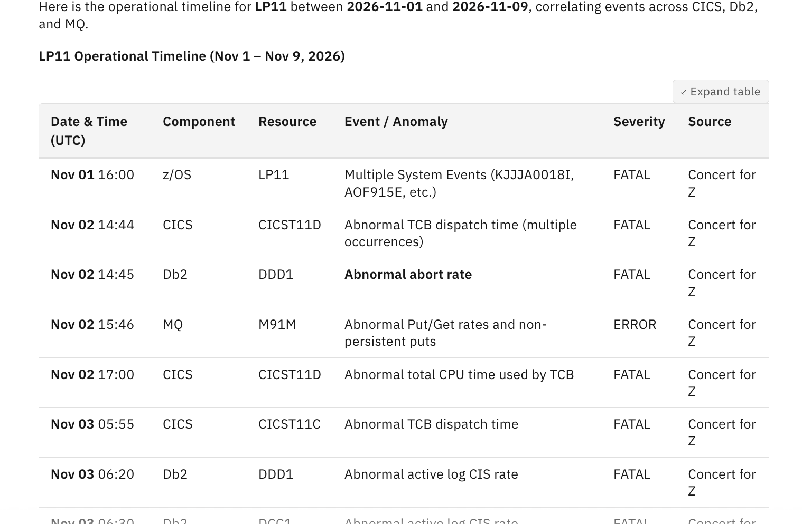
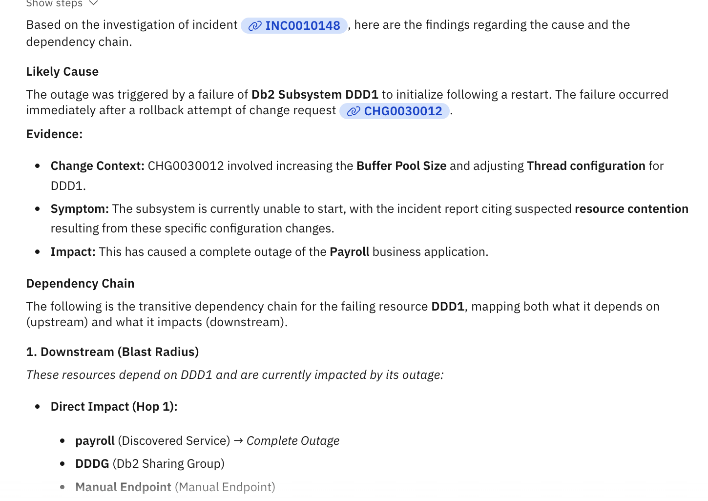
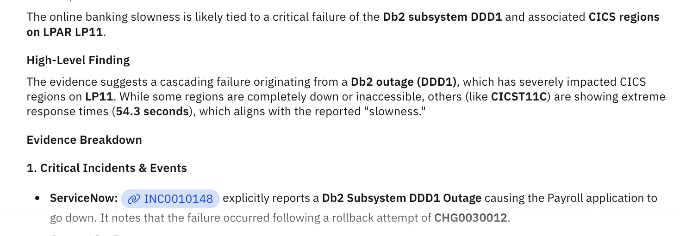
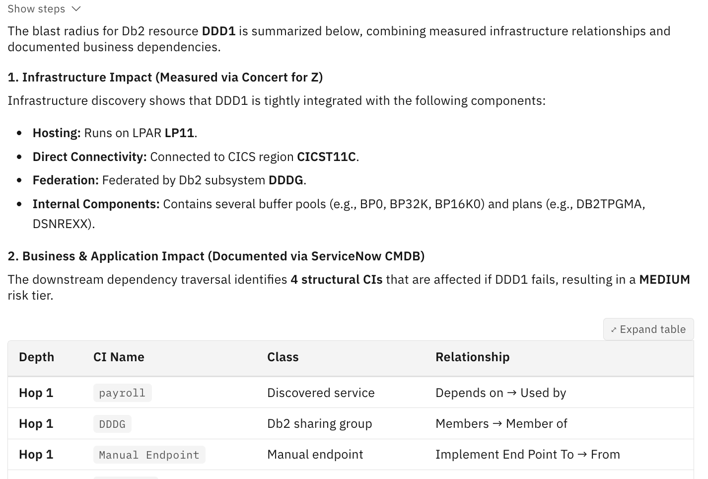
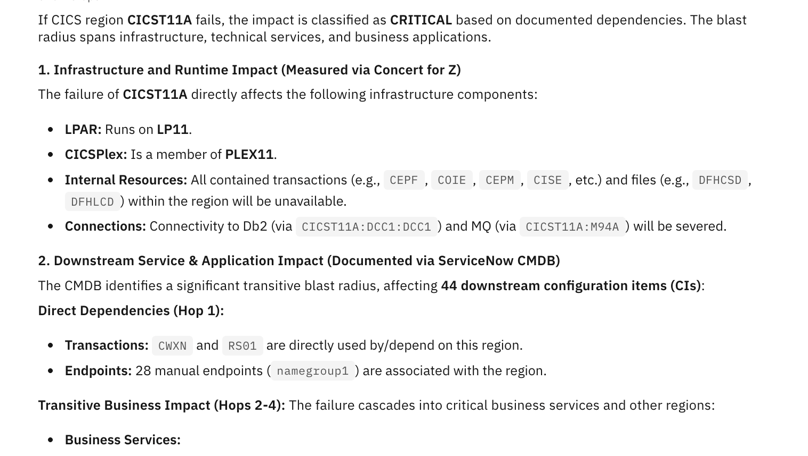
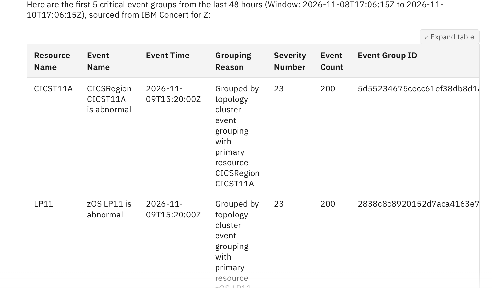

# Incident Analysis & Root Cause Investigation​

## Description

Correlate alerts, events, incidents, changes and dependencies across systems to accelerate diagnosis and identify probable causes of service disruptions. Combine Concert for Z, OMEGAMON, IMS, Db2 and ServiceNow evidence into timelines and ranked hypotheses, prepare shift handovers and post-incident reports, and create or update incident and change requests when asked.​


**Skill name:** `z-incident-investigator​​`

**Personas:** Incident Managers & Operations


**Data sources:** Alerts and events, ServiceNow, System map


## Demo Scenario: Anomaly Investigation and RCA


**Query** | **What the skill does** | **Expected result**
--- | --- | ---
*Which anomalies occurred on Sept 18 that I should be investigating?* | List critical anomalies from Concert for Z Sept 18 | ~4 critical anomalies, all relating to Db2
**[Optional]** *Respond to me as though I am a newbie in mainframe operations, including explaining what you are doing and all the terminology in details.* | Set persona for response content to be operations SME focused, resulting in substantially more detailed and thorough responses. | Summary of what it explained so far
*Which business applications are related to the anomalies?* | Leverage ServiceNow to map CMDB configuration items to business applications, resulting in the Payroll application being highlighted. | Payroll application identified as related to anomalies
*Which configuration items are related to the Payroll application?* | Identify the application to configuration item mapping for the Payroll application. | Summary of relatedConfiguration Items (CI's)
*Show a visual view of a topology map for the Payroll application, including 3 levels of mainframe resource dependencies.* | Leverage ServiceNow for multi-hop relationship traversal to identify the LPAR, subsystem and API components. | Well-formatted visual topology map 
*What is the blast radius for DDD1, and show a topology view of the blast radius* | Leverage service now application relationship mapping to identify downstream impacts for the DD1 resource. | Summary of the downstream resources impacted by DDD1 failing, including a visual map view
*Which incident is most related to this payroll application issue on September 18th?* | Incident search by description to identify most relevant incident | Identified incident record from ServiceNow with an explanation
*Is there a change request that may have impacted the Payroll application during this same time?* | Query ServiceNow for change requests that involved DDD1 and occurred prior to the Sept 18 event. | Suspicious Change Request identified, likely to be the smoking gun
*Based on the current failure of the Payroll app, what are the specific risks of rolling back CHG0030012, and which other systems might be affected by that rollback?* | Evaluate risks of performing a change rollback versus not rolling back the changes. | Comprehensive assessment and summary
*Generate a detailed report of the the potential rollback change request including all necessary evidence and justification so that it can be reviewed by the next shift to determine whether to move forward immediately or to wait for additional analysis. Save the report as a markdown file that can be downloaded* | Summarizes the details of the investigation and saves into a readable markdown report | Detailed report to be shared to team


## Additional prompts


```
Build a timeline for LP11 between 11/1/26 and 11/9/26. Include CICS, Db2, IMS, MQ and show anomalies.  ​
```




```
Investigate the likely cause of incident INC0010148 and show the dependency chain.​
```



```
Online banking became slow in the last few hours. Multiple teams are getting calls. What happened?
```




```
What is the blast radius for DDD1, and show a topology view of the blast radius
```



```
If CICS region CICST11A fails, what else is affected?
```



### Trend Analysis

```
Get the first 5 critical event groups from the last 48 hours
```


