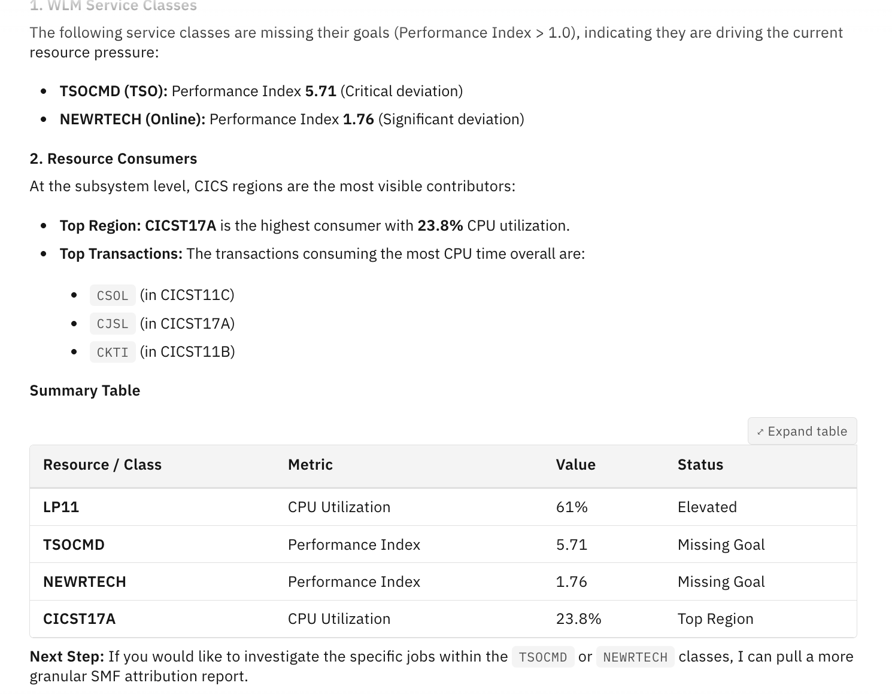
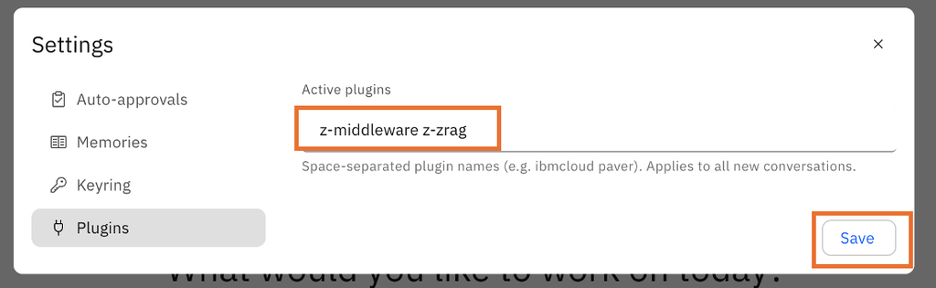

# Performance, Capacity & Cost Management​

## Description

Monitor CPU, zIIP, WLM, CICS, storage, network and workload utilization to identify performance bottlenecks, capacity risks and software cost drivers. Compare time windows, find workloads missing their WLM goals, and explore peak MSU drivers and estimated cost contributions; forecasts and estimates depend on available data and assumptions. Leverages data from OMEGAMON monitors, Concert for Z, and other system data.​

**Skill name:** `z-performance-capacity-and-cost​`

**Personas:** Performance Analysts, Capacity planners

Data sources:
- OMEGAMON monitoring
- Concert for Z


Sample Prompts:


## Sample Prompts

```
CPU utilization on TIVLP11 has been climbing since 09:00 this morning. Which jobs or service classes are driving it?
```




```
Which applications drove the highest MSU consumption on TIVLP11 last month and what is the estimated software cost contribution for each?
```

**IMAGE**

```
Compare CP and zIIP consumption by service class on TIVLP11 for today 09:00–17:00 against the same window last Tuesday.
```
**IMAGE**

```
What is the performance index for workload BATCH and service class BATNORML from 12 hours ago to now?
```

```
Which service classes in PAYPLEX missed their WLM goals during the last 24 hours?
```

---------------

## Overview of the `z-middleware` plugin

The `z-middleware` plugin consists of the following skills:

- **CICS TS Skills**
  - `cics-get-live-resource-info`
  - `cics-problem-determination`
  - `cics-rag-search`
  - `cics-response-sanitizer`
  - `cics-topology`

- **Db2z Skills**
  - `db2z-catalog-information`
  - `db2z-connection-resolver`
  - `db2z-system-information`


## Setting the Plugins

Ensure you’ve completed the steps in section **[Setting the Plugins](./02-getting-started/setup-configuration.md#setting-the-plugins)**. For the `z-middleware` plugin, the configuration should look like the following:



## Skills Summary

### CICS TS Skills

**Skill** | **Description** |
--- | --- |
`cics-topology` | Answer questions about CICS topology and architecture - how regions are structured (AOR, TOR, FOR, IOR, LOR, WOR), how they communicate (MRO, ISC, IPIC, DPL), how CICSplexes and CPSM/CMAS manage them, and how JVM servers, Liberty, coupling facilities, and high availability fit into the design.
`cics-get-live-resource-info` | Get live status and attributes of named CICS resources (transactions, programs, files, dumps, DB2/MQ connections, regions, tasks, DSAs, etc.) from a running CICS region or CICSplex. |
`cics-problem-determination` | Trigger when the user's message relates to a CICS error or problem, references a DFH code (complete or partial, e.g. DFHAC2032, DFHZC2302E, DFH0100, DFHAC, DFH), or asks to diagnose or explain a CICS message. |
`cics-response-sanitizer` | Cleans LLM-generated answers that were produced from zRAG document retrieval.
`cics-rag-search` | Builds optimised search queries for retrieving CICS documentation from a vector database. Use when you need to search for CICS topology, architecture, intercommunication, routing, JVM, or region information and want to maximise retrieval quality.

### Db2z Skills

**Skill** | **Description** |
--- | --- |
`db2z-catalog-information` | Answer Db2 for z/OS questions that need information from the catalog or user tables by running SQL against them — finding tables, discovering columns, querying data, generating SQL, and object-metadata lookups.
`db2z-connection-resolver` | Resolve Db2 for z/OS connection targets from the IBM Z service-endpoint registry into driver-ready ODBC/CLI connection profiles, with credentials referenced by name only, and test the connections end-to-end with the bundled script. |
`db2z-system-information` | Inspect the live operational state of a Db2 for z/OS subsystem — buffer pools, active threads and connections, DDF/distributed status, data-sharing group and group buffer pools, DSNZPARM system parameters, active traces, stored-procedure and utility status, lock blockers, and accelerator runtime status.


## Sample Demo Prompts

### CICS TS Skills

#### `cics-topology`

- How many JVM servers can I run in a single CICS region
- How should I connect my CICS regions?
- What are the three primary methods for connecting CICS regions?

#### `cics-get-live-resource-info`

- Can you tell me if the dsa RDSA short on storage?
- Get me information on active CICS regions, sit parameters configured and transaction TXN1

#### `cics-problem-determination`

- I am seeing error DFHAC2001 when running transaction TXN2
- I got error message DFHAD0001 due to an abend related to module DFHLEA. Can you help me diagnose this?
- 08.42.37 S2345678  DFH0100 IYK2ZWY1 CICS SUBSYSTEM IS NOW INITIALIZED. Is this subsystem initialization message normal or does it require any verification?


### Db2z Skills

#### `db2z-catalog-information`

- List the first 5 rows of SYSIBM.SYSTABLES table on DDD1 Db2 subsystem
- List all tables where column PARENTS is 1 on SYSIBM.SYSTABLES on DDD1 Db2 subsystem
- How many tables exists on DDD1 Db2 subsystem where CREATOR is NOT SYSIBM ?
- What columns does the SYSIBM.SYSTABLES catalog table have on the DDD1 Db2 subsystem?
- Which tables on the DDD1 Db2 subsystem have a name containing AUTH?


#### `db2z-connection-resolver`

- Resolve the connection details for my Db2 for zOS subsystems
- Run the bundled Db2 for z/OS connectivity test for DDD1 and report the per-endpoint results, including any resolver or credential errors verbatim.


#### `db2z-system-information`

- Is db2 subsystem DDD1 healthy ?
- Are there any blockers on DDD1 db2 subsystem?
- Which current Function Level is my Db2 subsystem DDD1 running and which one is the highest I can activate?
- What are the active traces on DDD1 Db2 subsystem?
- What are the ZPARM values for IRLMPRC and IRLMSID on DDD1 db2 subsystem ?
- Are there any tablespaces in RO (ReadOnly) status on DSNDB06 database on DDD1 Db2 subsystem?
- Provide me details on bufferpool BP0 on DDD1 Db2 subsystem

