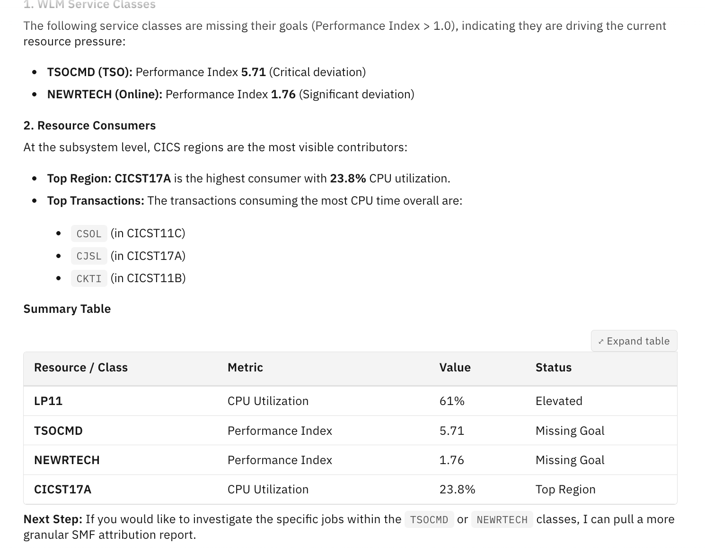
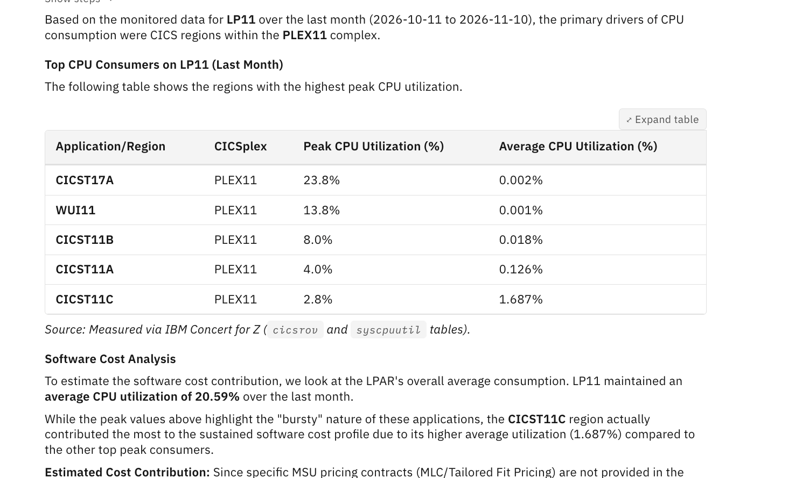
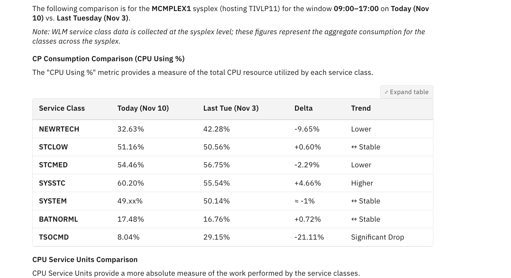
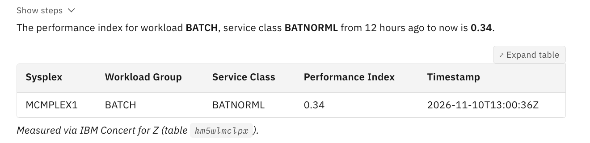
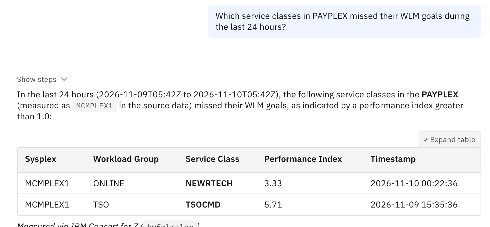

# Performance, Capacity & Cost Management​

## Description

Monitor CPU, zIIP, WLM, CICS, storage, network and workload utilization to identify performance bottlenecks, capacity risks and software cost drivers. Compare time windows, find workloads missing their WLM goals, and explore peak MSU drivers and estimated cost contributions; forecasts and estimates depend on available data and assumptions. Leverages data from OMEGAMON monitors, Concert for Z, and other system data.​

**Skill name:** `z-performance-capacity-and-cost​`

**Personas:** Performance Analysts, Capacity planners

Data sources:
- OMEGAMON monitoring
- Concert for Z


## Sample Prompts

```
CPU utilization on TIVLP11 has been climbing since 09:00 this morning. Which jobs or service classes are driving it?
```




```
Which applications drove the highest MSU consumption on LP11 last month and what is the estimated software cost contribution for each?
```




```
Compare CP and zIIP consumption by service class on TIVLP11 for today 09:00–17:00 against the same window last Tuesday.
```




```
What is the performance index for workload BATCH and service class BATNORML from 12 hours ago to now?
```




```
Which service classes in PAYPLEX missed their WLM goals during the last 24 hours?
```


