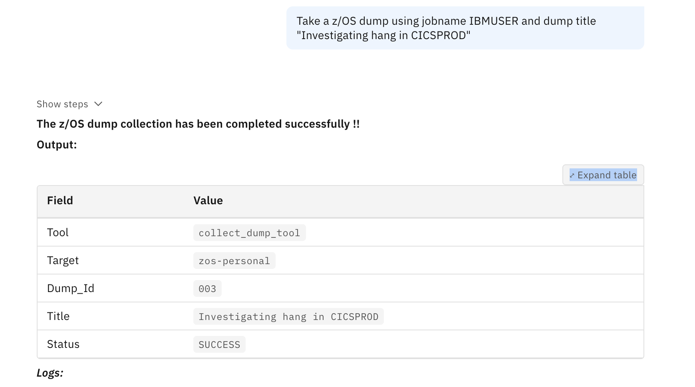
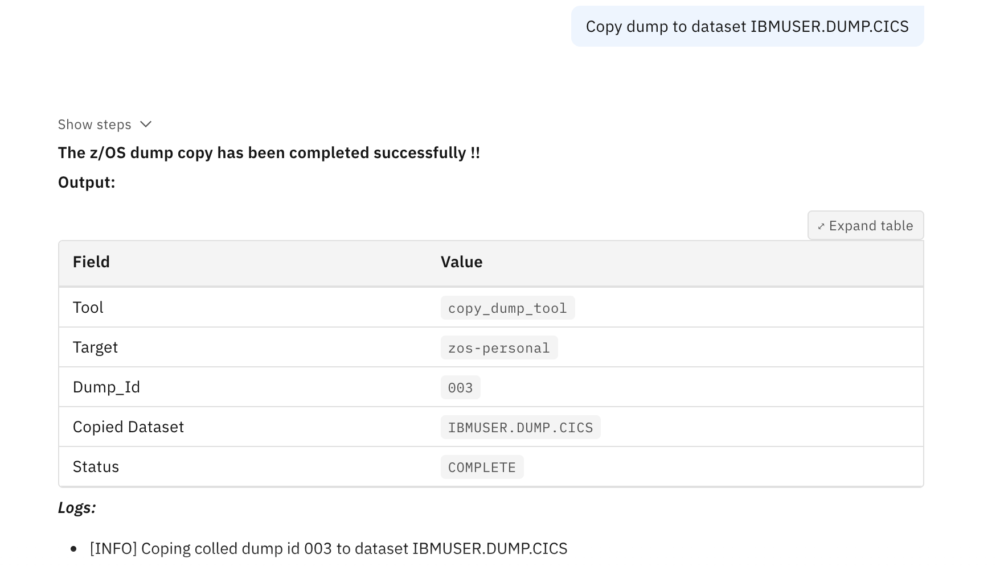
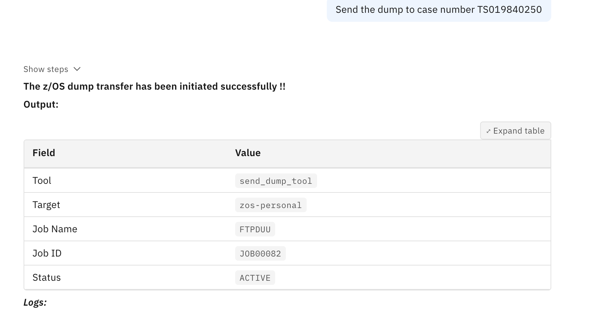
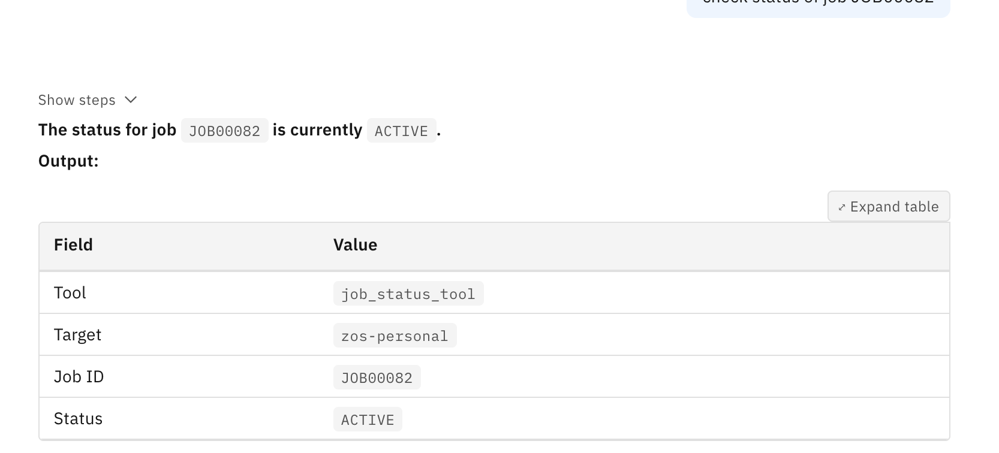

# System Operations & Recovery​

## Description

Investigate system health, automation status, started tasks, console activity, IPL readiness, dumps and recovery procedures to resolve operational issues faster. Review outstanding replies, Z System Automation states and NetView CANZLOG entries, and collect z/OS dumps or send them to an IBM support case when requested.​


**Skill name:** `z-system-operations​`

**Personas:** Operators, System Programmers​


Data sources:
- System Automation
- NetView
- Dump Service

## Sample Prompts

```
Show the current health of all z/OS subsystems on TIVLP11 — which are up, which are down, and which have issues.
```

```
Which resources in the MCMPLEX1 INGXSGLP domain on TIVLP11 show a desired-versus-observed state mismatch right now?
```

```
Show resource members for resource AM_X and type APG in domain MCMPLEX1 INGXSGLP
```

```
We plan to IPL TIVLP11 at 02:00. What readiness checks should we review?”
```


### Dump Management Prompts

**Taking a z/OS Dump:**
```
Take a z/OS dump using jobname IBMUSER and dump title "Investigating hang in CICSPROD"
```




**Copying dump to a target dataset:**
```
Copy the dump to dataset IBMUSER.DUMP.CICS
```



**Sending dump to a Support ticket:**
```
Send the dump to case number TS019840250
```




**Check status of dump transfer job:**
```
Check status of job JOB00082
```



