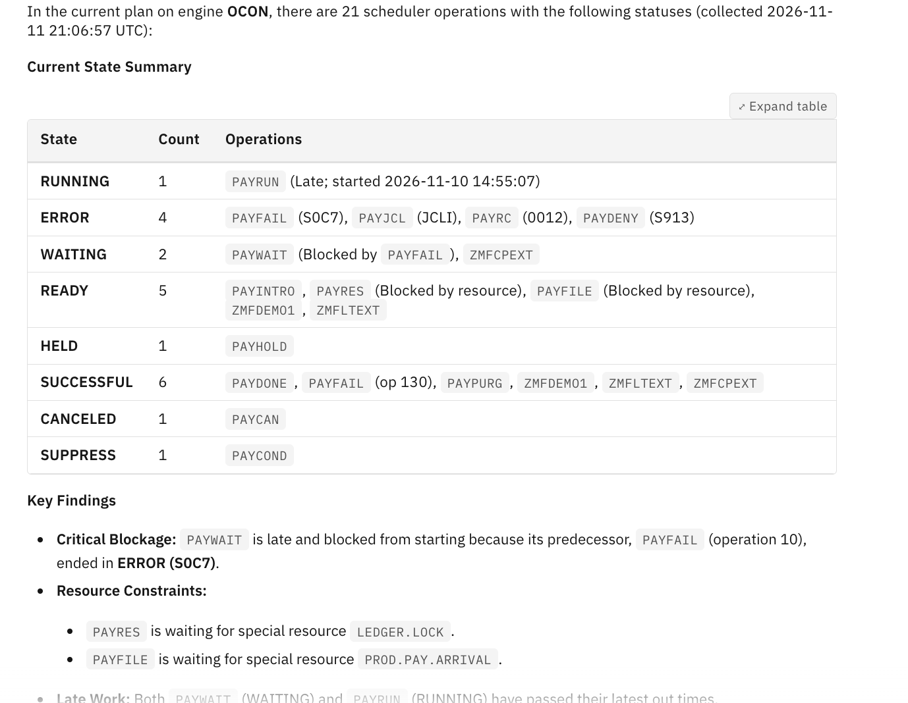
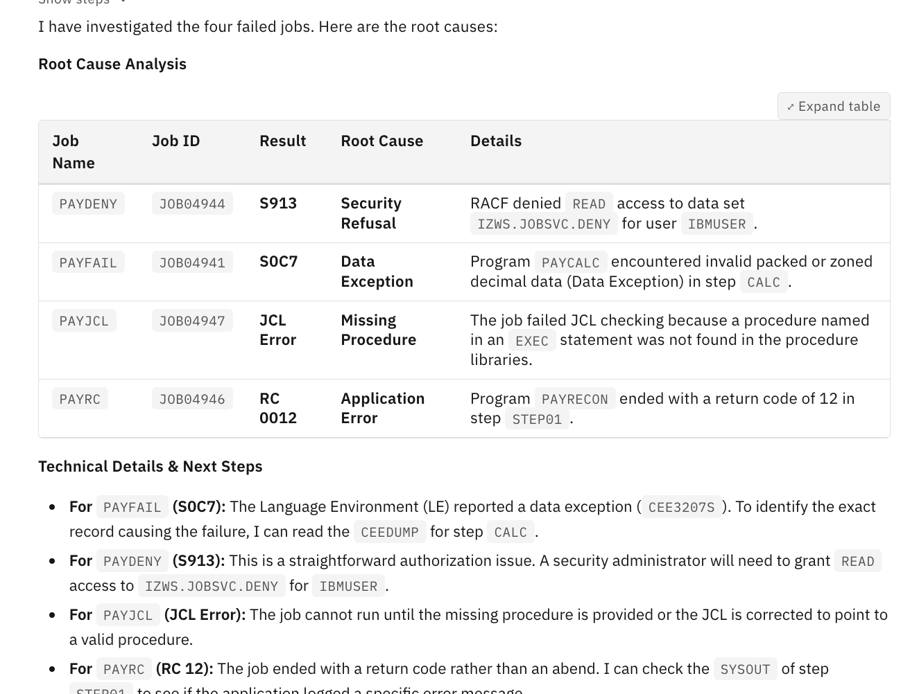
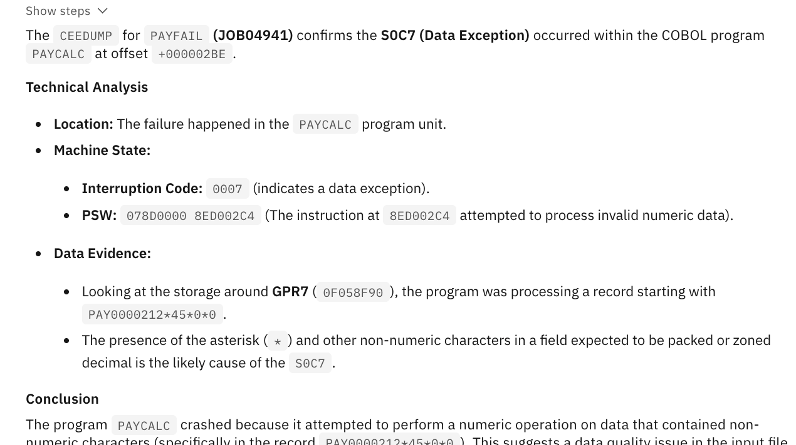
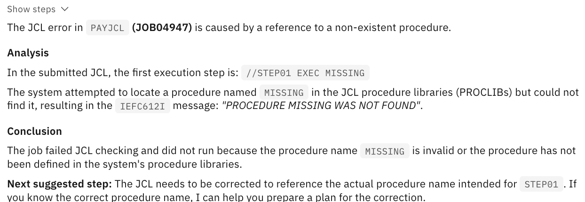
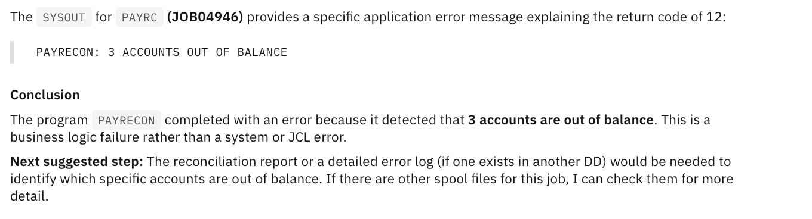
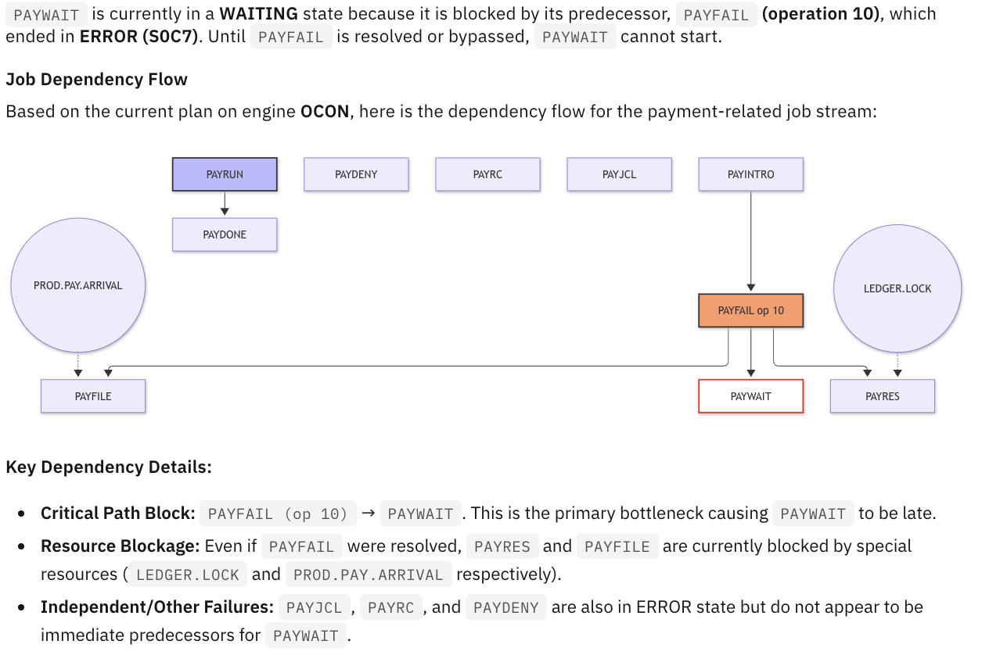
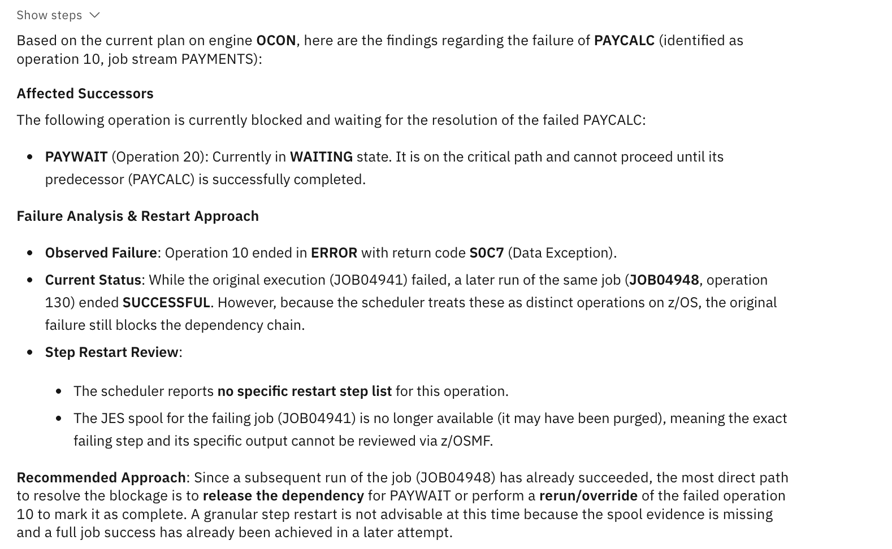
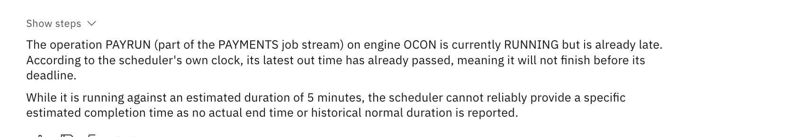

# Batch Operations & Scheduling

## Description

Analyze delayed, stalled or failed batch workloads by examining schedules, dependencies, resources, critical paths, job execution and completion status. The agent connects IBM Z Workload Scheduler plans to JES jobs, JCL and spool output, estimates deadlines, assesses downstream impact and proposes restarts.​

**Skill name:** `z-job-and-scheduling-operations​`

**Personas:** Operations Teams​


Data sources:
- Job Scheduler (IZWS)
- z/OSMF


## Example Demo Scenario: Investigating failed jobs

```
What is the status of my job streams?
```



```
Investigate the root cause of the failed jobs
```



```
Examine the CEEDUMP to provide more details on the error for PAYFAIL
```



```
Analyze the JCL error in PAYJCL
```



```
For PAYRC analyze the SPOOL data for more details
```



```
What is PAYWAIT waiting for? Create a flow diagram of the job dependencies
```



### Other Sample prompts

```
PAYCALC failed on SCH1. Which successors are affected, and what step restart approach should we review?
```



```
Will application PAYMENTS on SCH1 finish before its deadline, and what is its estimated completion time?
```




```
Review workload dependencies and execution paths
```
