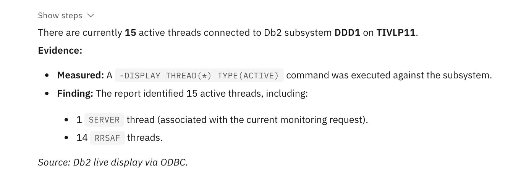
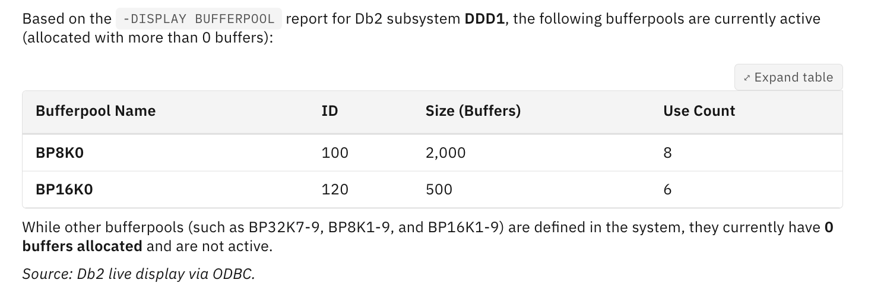
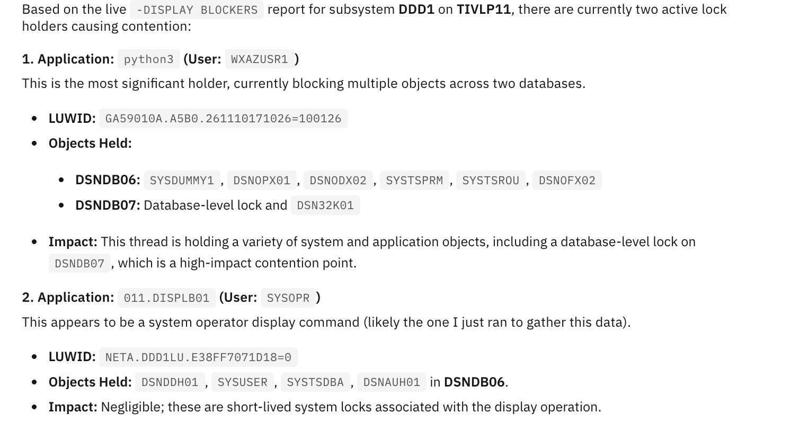
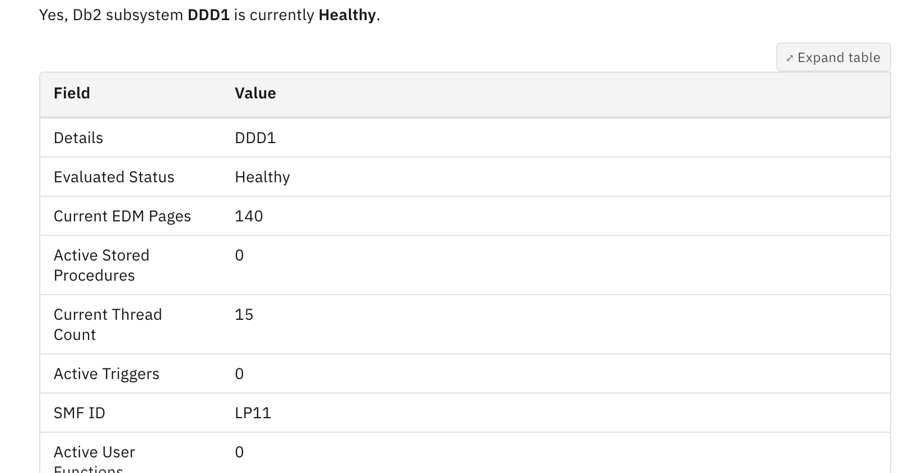
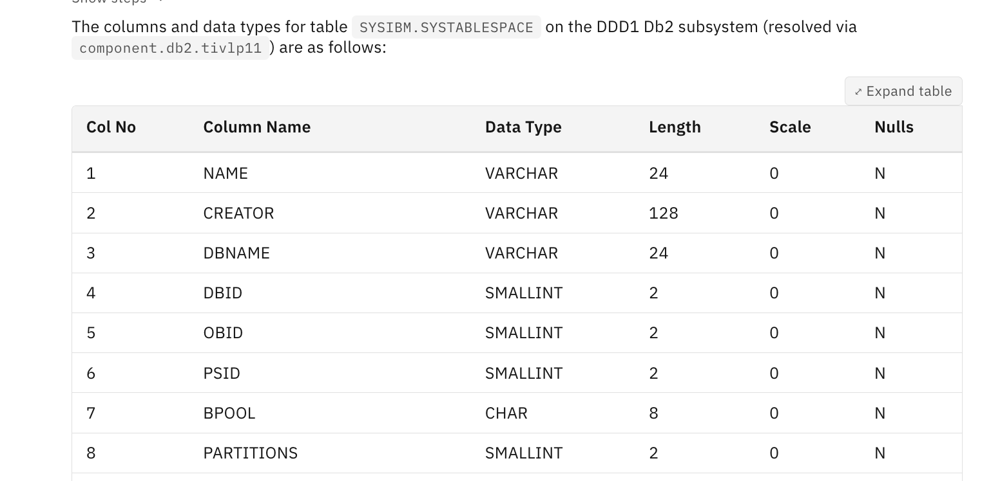
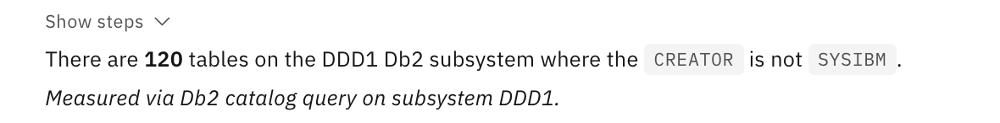
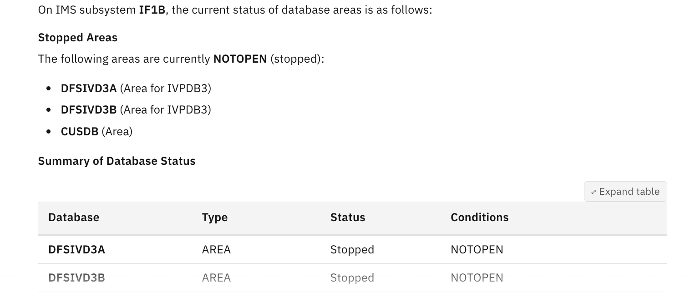
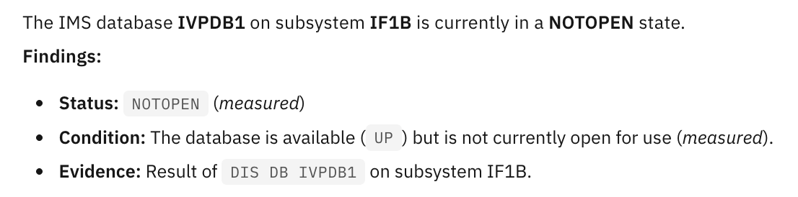

# Database Operations and Availability

## Description

Investigate Db2 and IMS health, availability, contention, locks, utilities, configuration settings and performance issues impacting database services. Inspect Db2 threads, buffer pools and log usage, check IMS database status and stopped areas, compare Db2 accounting across time windows, and generate SQL for review. Gets data directly from Db2, IMS, and corresponding OMEGAMON monitoring.​

**Skill name:** `z-database-operations​`

**Personas:** DBAs, System Programmers​


Data sources:
- Db2
- IMS
- OMEGAMON Monitoring

## Sample Prompts

### Db2 System Information

```
How many active threads are currently connected to Db2 subsystem DDD1 on TIVLP11?
```




```
List all active bufferpools on DDD1 Db2 subsystem
```



```
What are the ZPARM values for IRLMPRC and IRLMSID on DDD1 db2 subsystem
```

```
We are getting Db2 lock timeouts on subsystem DDD1 (TIVLP11). Which application is causing it?
```



```
Is db2 subsystem DDD1 healthy?
```



### Db2 Catalog Queries

```
What are the columns and their data types for table SYSIBM.SYSTABLESPACE on the DDD1 Db2 subsystem?
```



```
How many tables exists on DDD1 Db2 subsystem where CREATOR is NOT SYSIBM ?
```



### IMS Database Queries

```
Show the current status of IMS database areas on IF1B. Which areas are stopped?
```



```
Check the status of IMS database IVPDB1 on subsystem IF1B to see if it is started, stopped, or in an error state.
```

