# Transaction and Messaging Runtime Diagnostics​

## Description

Troubleshoot CICS, IMS, MQ and Java environments by tracing transactions, runtime resources, dependencies and application failures. Examine CICS regions, programs and files, IMS transaction states and queues, MQ and JVM lock information and z/OS Connect API errors, with topology and IMSplex-wide checks. Leverages data coming from CICS, IMS, OMEGAMON, and Concert for Z.​

**Skill name:** `z-transaction-and-messaging-operations​​`

**Personas:** Application Support Teams​


Data sources:
- CICS
- IMS
- OMEGAMON Monitoring
- Concert for Z


## Sample Prompts

### IMS 

```
List all IMS transactions and their queue counts on subsystem IF1B.
```
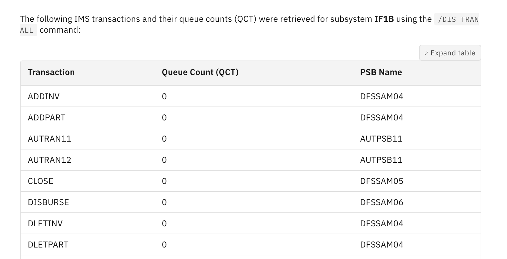


```
What is the current status of IMS transaction IVTNO on IF1B IMS subsystem?
```
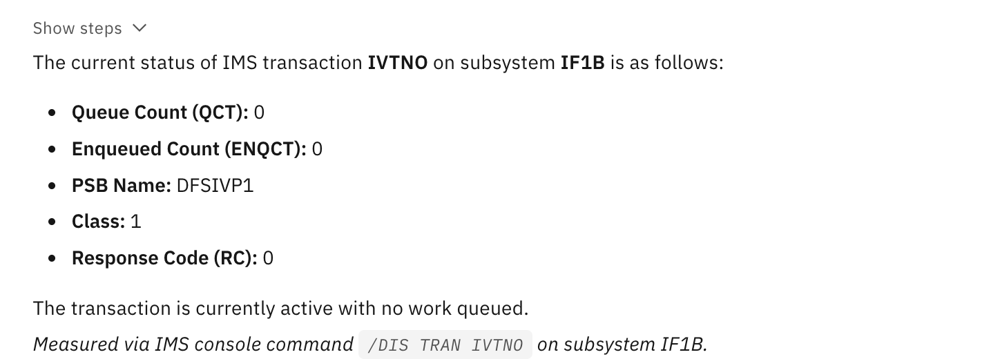


```
Show the status of IMS Fast Path transaction FPSAMP1 on IF1B IMS subsystem.
```
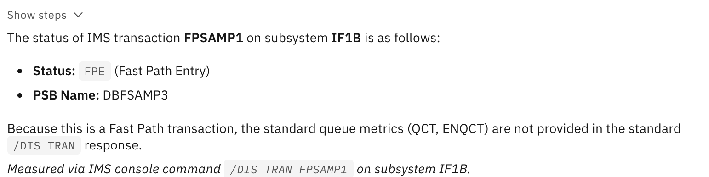


### CICS

```
Show all CICS CCTL connections on IF1B IMS subsystem using /DIS CCTL.
```
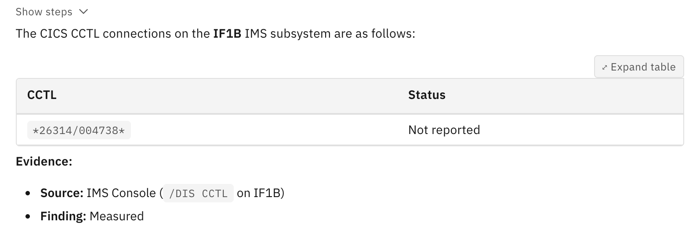


```
Get the details for transaction dump code AAL8 and system dump code EYU0XZPT in the current CICS region
```
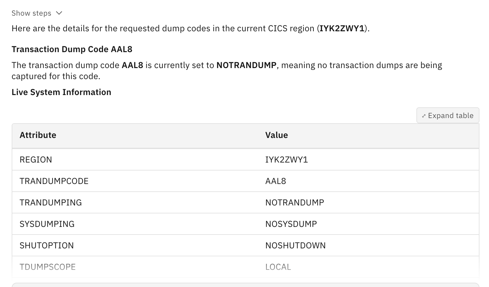


```
Which program is executed first when Transaction TXN2 starts, and what language is it written in?
```
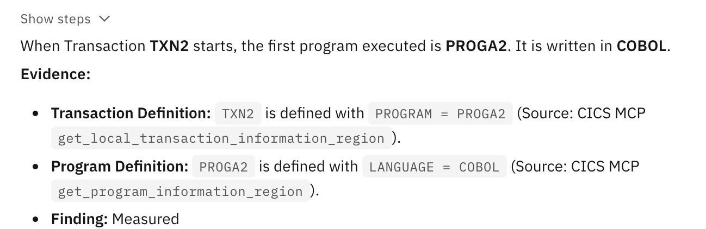


```
Fetch me information on program PROGA5 in my CICS system
```
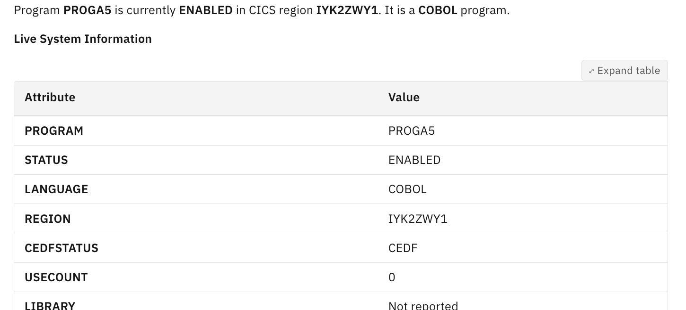


```
Is the program executed by Transaction TXN1 currently available for use?
```
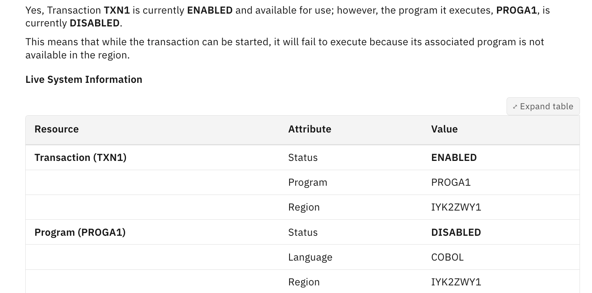


```
Get me information on active CICS regions, sit parameters configured and transaction TXN1
```
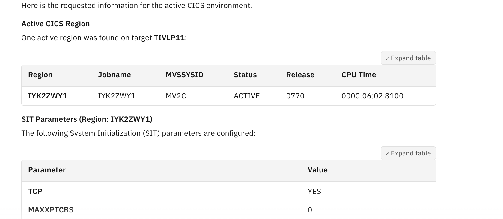


### JVM and JVM Lock queries

```
Retrieve details of all JVMs.
```
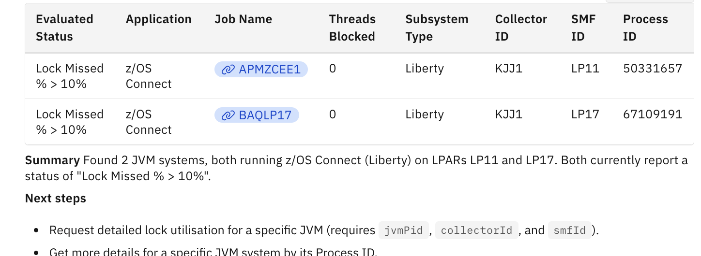


```
List all available details for each JVM
```
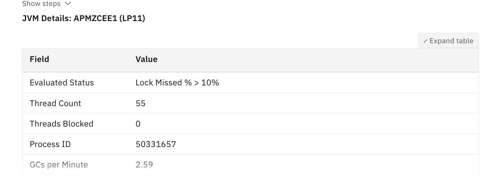


```
Provide detailed information for JVM APMZCEE1
```


```
Show locks for JVM instance APMZCEE1
```
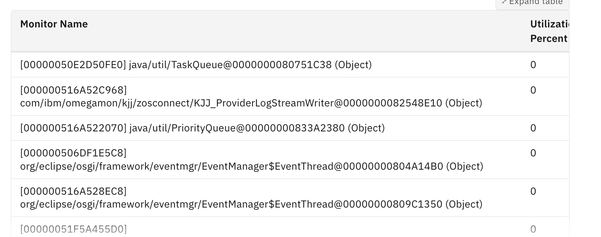


### MQ Managers and Queue Questions

```
List all MQ Managers.
```
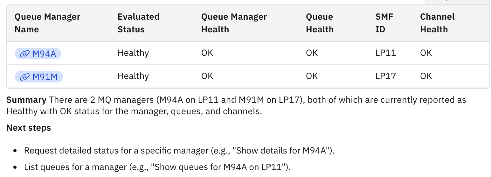


```
Provide full details for MQ manager M94A
```

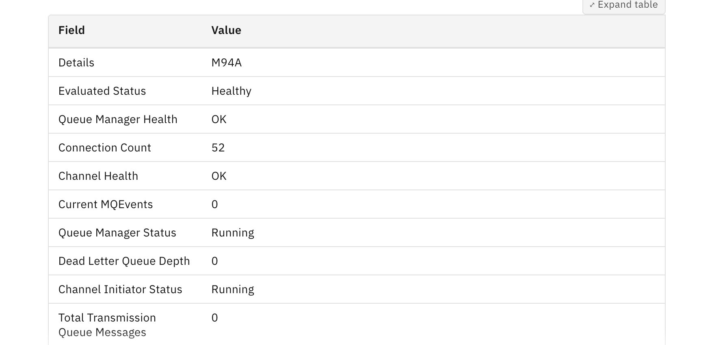

```
Show queue details for MQ manager M94A
```

```
Show me the MQ connections for CICS region IYCWENW1
```
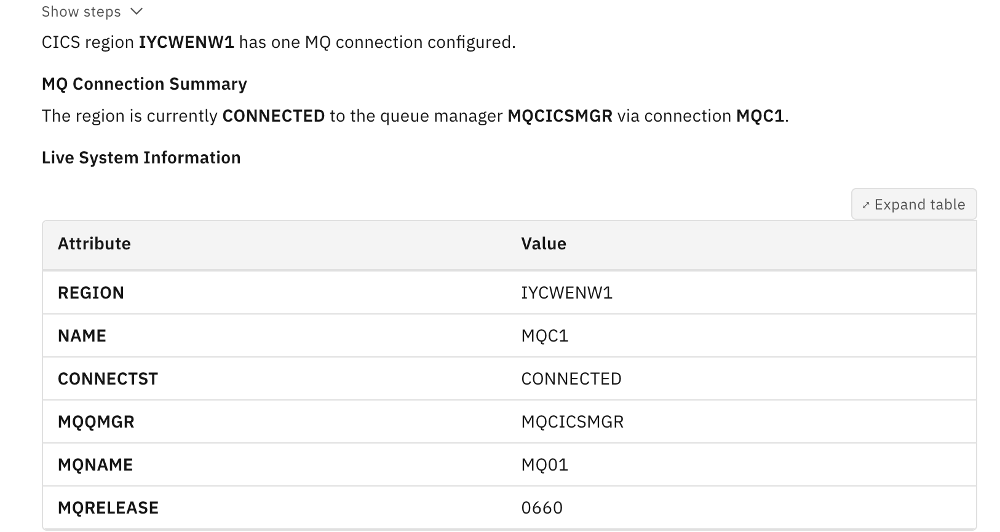

