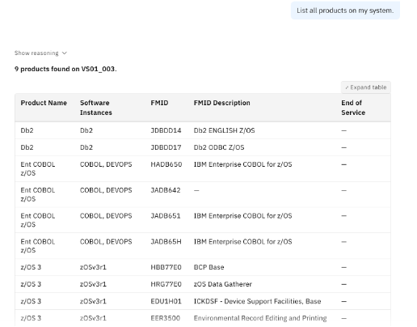
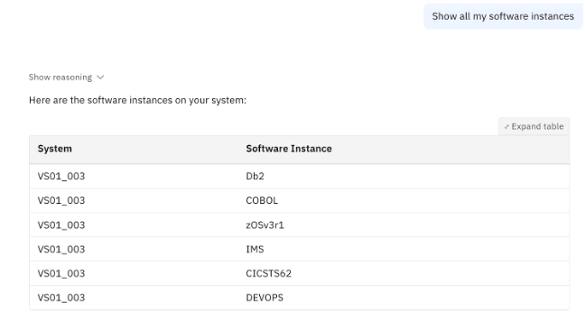
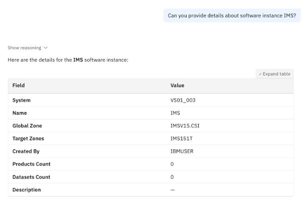
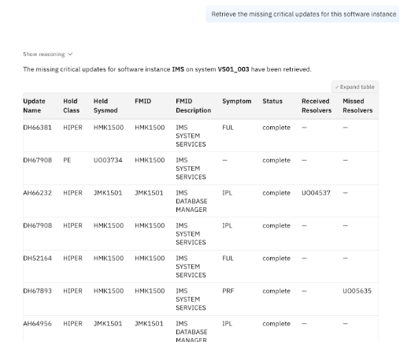
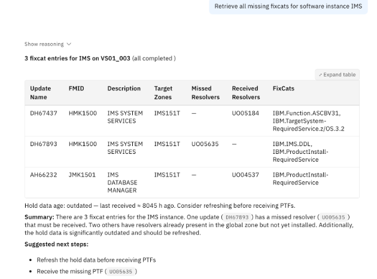
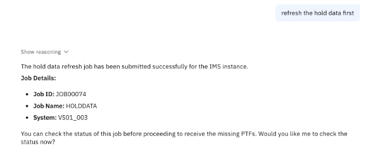
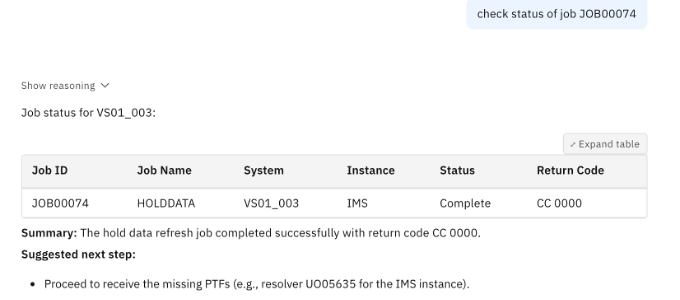
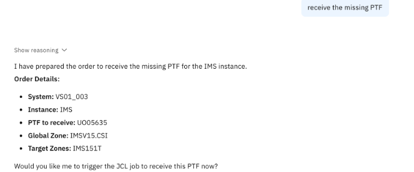

# Software Maintenance & Currency​

## Description

Identify missing HIPER, PE, APAR and FIXCAT updates, review software inventory, and maintain visibility into system maintenance requirements. The agent can also receive a requested PTF and report its installation or related job status, so teams can prepare maintenance and follow progress. Connects to z/OSMF and ServiceNow.​

**Skill name:** `z-change-configuration-and-maintenance​​`

**Personas:** System Programmers

**Data sources:** z/OS, z/OSMF


## Demoing the skill

**Pre-req:** Ensure you completed the setup in [this section](./02-getting-started/config-auth-personal.md).


### Retrieve a list of all products registered on the system:

```
List all products on my system.
```



### List all software instances 

```
Show all my software instances
```



### Show details for a particular software instance

```
Can you provide details about software instance IMS?
```



 
### Retrieve missing critical updates for a SWI

```
Retrieve the missing critical updates for this software instance
```




### Retrieve missing fixcats for a SWI

```
Retrieve all missing fixcats for software instance IMS.
```



### Refresh the hold data

```
Refresh the hold data first
```



### Check job status

```
Check the status of job xxx
```




### Receive missing PTFs

```
Receive the missing PTF
```


