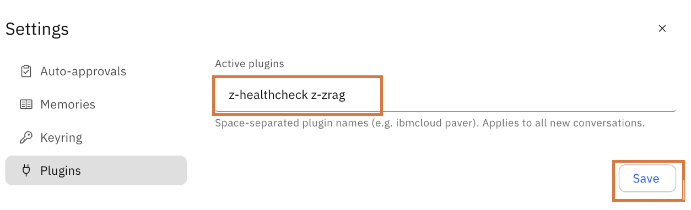

# Database Operations and Availability

## Description

Investigate Db2 and IMS health, availability, contention, locks, utilities, configuration settings and performance issues impacting database services. Inspect Db2 threads, buffer pools and log usage, check IMS database status and stopped areas, compare Db2 accounting across time windows, and generate SQL for review. Gets data directly from Db2, IMS, and corresponding OMEGAMON monitoring.​

**Skill name:** `z-database-operations​`

**Personas:** DBAs, System Programmers​


Data sources:
- Db2
- IMS
- OMEGAMON Monitoring

## Sample Prompts

### Db2 System Information

```
How many active threads are currently connected to Db2 subsystem DDD1 on TIVLP11?
```

```
List all active bufferpools on DDD1 Db2 subsystem
```

```
What are the ZPARM values for IRLMPRC and IRLMSID on DDD1 db2 subsystem
```

```
We are getting Db2 lock timeouts on subsystem DDD1 (TIVLP11). Which application is causing it?
```

```
Is db2 subsystem DDD1 healthy ?
```

### Db2 Catalog Queries

```
What are the columns and their data types for table SYSIBM.SYSTABLESPACE on the DDD1 Db2 subsystem?
```

```
How many tables exists on DDD1 Db2 subsystem where CREATOR is NOT SYSIBM ?
```


### IMS Database Queries

```
Show the current status of IMS database areas on IF1B. Which areas are stopped?
```

```
Check the status of IMS database IVPDB1 on subsystem IF1B to see if it is started, stopped, or in an error state.
```


## Overview of the `z-healthcheck` plugin

The `z-healthcheck` plugin is a tech preview that provides point-in-time z/OS health diagnostics delivered conversationally. Natural-langugage health queries are routed over A2A (Agent-to-Agent) to the Medea Z Agent, which selects the appropriate diagnostic workflow, runs read-only checks against the target LPAR, and returns findings grounded in live system evidence. 

## Supported Health Areas

**Workflow** | **Area / Subsystem** | **Covers**
--- | --- | ---
`health_checker` | IBM Health Checker | Active exceptions and severity checks
`jes2_health` | JES2 Subsystem | Subsystem status and JES2 health
`jes2_spool` | JES2 spool | Spool utilization and capacity risk
`storage` | Storage & Memory | DASD, paging, and SMS pressure
`sysplex` | Parallel Sysplex | Sysplex status, XCF, and coupling facilities
`sysplex_net` | Sysplex Network | Sysplex Distributor and dynamic VIPA
`wlm` | Workload Manager | WLM goals, service classes, and health
`network` | Network Connectivity | TCP/IP stacks and VTAM connectivity
`performance` | System Performance | CPU, paging, I/O rates, and resource pressure
`contention` | Resource Contention | GRS ENQ contention, latches, and deadlocks


## Setting the Plugin

Ensure you’ve completed the steps in section **[Setting the Plugins](./02-getting-started/setup-configuration.md#setting-the-plugins)**. For the `z-healthcheck` plugin, the configuration should look like the following:



## Demo Script (Sample Prompts to test)

- Perform a system health check and tell me if anything needs attention.
- Are there any medium- or high-severity Health Checker exceptions?
- Is JES2 healthy right now?
- How is JES2 spool utilization? Is there any capacity risk?
- Check storage health. Are DASD, paging, or SMS under pressure?
- Is the Sysplex healthy and are all members communicating normally?
- Are TCP/IP and VTAM healthy, or do you see connectivity issues?
- Are there any GRS ENQ contention or deadlock issues affecting the system?
- Is SYSB OK right now? Are there any problems I should know about?
- Which health check owner has the most exceptions on SYSB?


