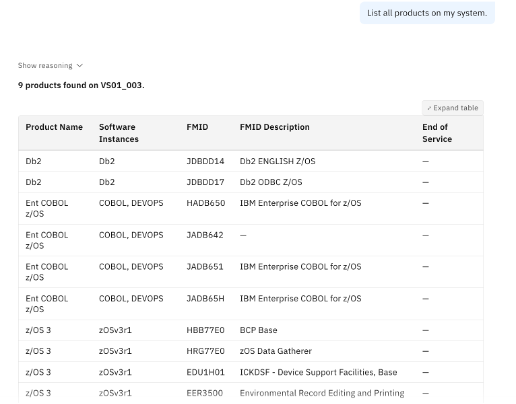
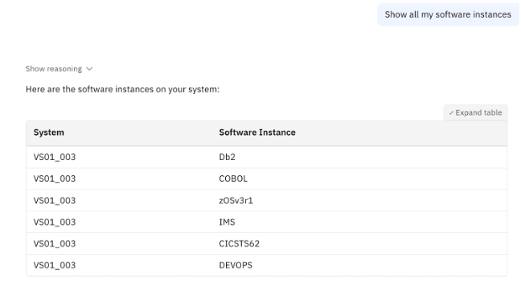
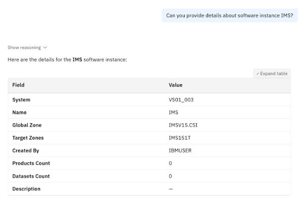
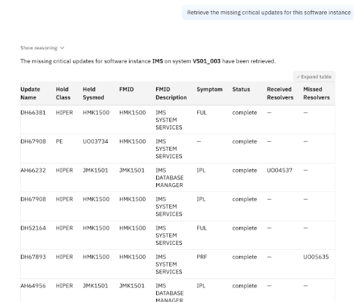
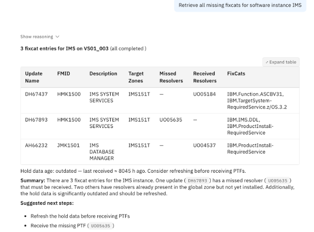
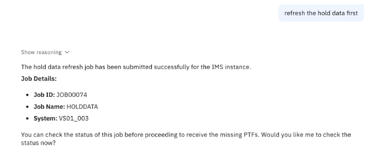
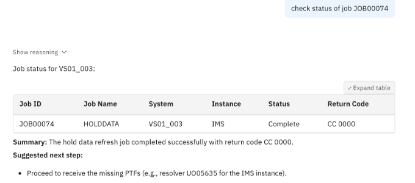
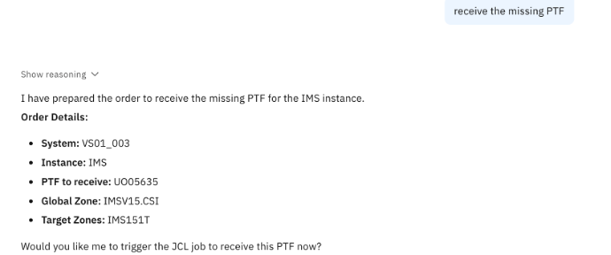
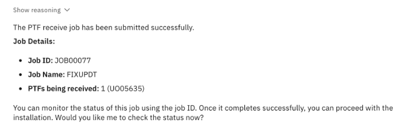

# Software Maintenance and Currency

## Description

Identify missing HIPER, PE, APAR and FIXCAT updates, review software inventory, and maintain visibility into system maintenance requirements. The agent can also receive a requested PTF and report its installation or related job status, so teams can prepare maintenance and follow progress. Connects to z/OSMF and ServiceNow.​

**Skill name:** `z-change-configuration-and-maintenance​​`

**Personas:** System Programmers

Data sources:
- z/OSMF Software Management
- ServiceNow

## Demoing the skill

**Pre-req:** *Ensure you completed the setup section specifically for demoing this skill and the `zos-dump-management`*.

1. First, you may want to retrieve a list of all products that are registered on the system.
   
   **PROMPT**: *List all products on my system.*

   

   And the agent returns a list of all the various products and supporting FMID’s available on the system, including an End of Service date if any.

2. Next, query for all the software instances that are available.
   
   **PROMPT**: *Show all my software instances*

   

   The agent then returns a list of all software instances registered, returning each instance name alongside the system it belongs to. 

3. You may want to get more details about a software instance, for example:
   
   **PROMPT**: *Can you provide details about software instance IMS?*

   

   More details are returned for the selected software instance, including the Global Zone, Target Zone, creator, etc.

4. To drill down deeper, lets check if there are any missing critical updates or missing fixcats for that software instance.
   
   **PROMPT**: *Retrieve the missing critical updates for this software instance*

   

   A list of all the critical updates for the software instance is returned, including details about hold class, hold symptoms, held SYSMODs, target zones, and resolver status, along with a hold-data age warning and a remediation summary.

5. Additionally, you can retrieve a list of **all missing fixcat updates** for that software instance.
   
   **PROMPT**: *Retrieve all missing fixcats for software instance IMS.*

   

   The agent will return a list of all the missing fixcat updates. Then it suggests next steps, for example, refreshing the hold data or receiving the PTFs.

6. Prompt the agent to refresh the hold data first.
   
   **PROMPT**: *Refresh the hold data first*

   

   The agent returns a confirmation with the Job ID for the holddata job. 

   Prompt the agent for the latest status

   **PROMPT**: *Check the status of job xxx (depending on your returned job id)*

   

   Eventually, the agent will confirm that the hold data refresh job completed successfully. 

7. Now, you can instruct the agent to proceed with receiving the missing PTF from earlier, for example:
   
   **PROMPT**: *Receive the missing PTF*

   

   It will then return the details of the order job before it submits. 

8. Prompt the agent to trigger the job.
   
   **PROMPT**: *Trigger the job*

   

9. Like before, prompt the agent for the latest status of the RECEIVE job using the job ID it returned, until you receive a successful response code. 