# Middleware Runtime Diagnostics

## Description

Troubleshoot CICS, IMS, MQ and Java environments by tracing transactions, runtime resources, dependencies and application failures. Examine CICS regions, programs and files, IMS transaction states and queues, MQ and JVM lock information and z/OS Connect API errors, with topology and IMSplex-wide checks. Leverages data coming from CICS, IMS, OMEGAMON, and Concert for Z.​

**Skill name:** `z-transaction-and-messaging-operations​​`

**Personas:** Application Support Teams​


Data sources:
- CICS
- IMS
- OMEGAMON Monitoring
- Concert for Z


## Sample Prompts

### IMS 

```
List all IMS transactions and their queue counts on subsystem IF1B.
```

```
What is the current status of IMS transaction IVTNO on IF1B IMS subsystem?
```

```
Show the status of IMS Fast Path transaction FPSAMP1 on IF1B IMS subsystem.
```


### CICS

```
Show all CICS CCTL connections on IF1B IMS subsystem using /DIS CCTL.
```

```
Get the details for transaction dump code AAL8 and system dump code EYU0XZPT in the current CICS region
```

```
Which program is executed first when Transaction TXN2 starts, and what language is it written in?
```

```
Fetch me information on program PROGA5 in my CICS system
```

```
Is the program executed by Transaction TXN1 currently available for use?
```

```
Get me information on active CICS regions, sit parameters configured and transaction TXN1
```


### JVM and JVM Lock queries

```
Retrieve details of all JVMs.
```

```
List all available details for each JVM
```

```
Provide detailed information for JVM APMZCEE1
```


```
Show locks for JVM instance APMZCEE1
```


### MQ Managers and Queue Questions

```
List all MQ Managers.
```

```
Provide full details for MQ manager M94A
```

```
Show queue details for MQ manager M94A
```

```
Show me the MQ connections for CICS region IYCWENW1
```


## Overview of the `z-foundational` plugin

The `z-foundational` plugin consists of the following skills:
- OMEGAMON Insights
- Automation Insights
- Workload Schduler Insights
- Upgrade skill
- z/OS Dump Management Skill


## Summary of skills

<table>
  <thead>
    <tr>
      <th>Skill</th>
      <th>Description</th>
    </tr>
  </thead>
  <tbody>
    <tr>
      <td><strong>OMEGAMON Insights</strong></td>
      <td>Use this skill to query operational data for IBM Z subsystems and components. Use this whenever a user wants to list, retrieve, or show information for:
        <ul>
          <li>CICS</li>
          <li>Db2</li>
          <li>IMS</li>
          <li>JVM</li>
          <li>LPAR</li>
          <li>MQ</li>
          <li>Network</li>
          <li>Storage</li>
          <li>Situation events across any Z component</li>
        </ul>
      </td>
    </tr>
    <tr>
      <td><strong>Automation-Insights</strong></td>
      <td>Query live IBM Z Automation Insights data leveraging IBM Z System Automation and IBM Z NetView. Use whenever the user asks about automation domains (also known as SA z/OS subplexes or SA Plexes), systems, or automated resources — including listing, filtering by state or type, viewing members, relations, or pending requests.
      </td>
    </tr>
    <tr>
      <td><strong>Workload-Scheduler</strong></td>
      <td>This skill fetches live IBM Z Workload Scheduler operational data to answer user’ questions about scheduled tasks, batch jobs, or workload automation running on IBM Z (mainframe) or distributed systems.
      </td>
    </tr>
    <tr>
      <td><strong>Upgrade-skill</strong></td>
      <td>Handles z/OS software maintenance and upgrade tasks via z/OSMF and SMP/E:
        <ul>
          <li>retrieves software instances and products</li>
          <li>specific instance details</li>
          <li>checks missing fixcat updates by instance or product</li>
          <li>checks missing critical updates such as High Impact (HIPERs), PTF in Error (PEs), and Security or Integrity (SECINTs) fixes by HOLD class</li>
          <li>refreshes HOLD data</li>
          <li>receives PTFs</li>
          <li>installs PTFs</li>
          <li>resumes or cancels installs</li>
          <li>copies the install output</li>
          <li>checks z/OS hardware compatibility</li>
          <li>and monitors JCL jobs for PTF receive and HOLD data refresh.</li>
        </ul>
      </td>
    </tr>
    <tr>
      <td><strong>z/OS Dump Management</strong></td>
      <td>Manages the operational lifecycle of z/OS dumps — dump collection, collection status verification, dump transfer, and transfer status verification
      </td>
    </tr>
  </tbody>
</table>


## Setting the Plugins

Ensure you’ve completed the steps in section **[Setting the Plugins](./02-getting-started/setup-configuration.md#setting-the-plugins)**. For the `z-foundational` plugin, the configuration should look like the following:

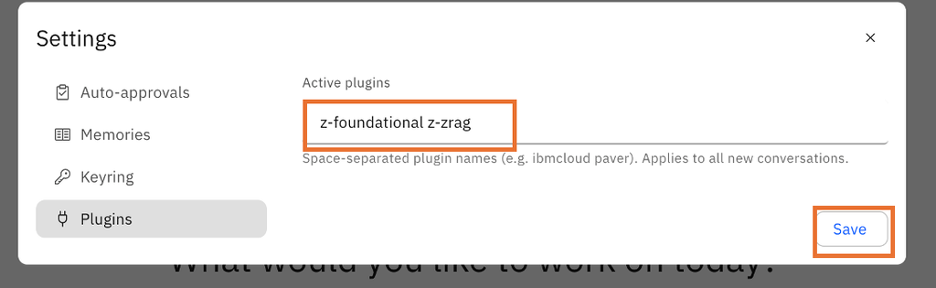


## Configuring z/OS environment for `upgrade` and `zos-dump-management` skills

In order to demonstrate the `upgrade` and `zos-dump-management` skills, you will need to setup your own z/OS environment which you can use as the target for these two skills. This is done via keyrings and the steps are outlined below:

1. Provision a demo environment (i.e. zD&T) from TechZone **<a href="https://techzone.ibm.com/my/reservations/create/69c99ef33dc0863bd858581c" target="_blank">here</a>**


2. Once the environment is ready, follow the steps here to **<a href="https://ibm.github.io/wxa4z-L4-Agentic/techzone/zdt/#accessing-the-environment" target="_blank">Access your environment</a>** and **<a href="https://ibm.github.io/wxa4z-L4-Agentic/techzone/zdt/#set-new-passphrase-for-ibmuser" target="_blank">set a new passphrase</a>** for the default **IBMUSER** user ID ***(you will need this password value later for executing the skills)***. 
   - Record the passphrase value you used in the steps referenced above

3. Next, you will need to generate a **transfer id** and **password** for the purpose of the support-skill. 

    a) Navigate to the **<a href="https://www.ecurep.ibm.com/transferids/" target="_blank">IBM Support File Transfer ID Management</a>** page.
    
    b) Click **Generate a new transfer ID**

    c) After generating, a window will appear showing your Transfer ID and Password. *Ensure you record the value of both - you won't be able to view afterwareds*. 

4. Ensure you have the following information ready and then navigate back to the Preview UI environment:

   - **Public IP** of your zD&T environment
   - **Passphrase** value you set for the default IBMUSER ID
   - **Transfer ID and password** values generated previously

5. Once you’re back at the **Chat** view of the UI, navigate to **All settings** by clicking on the gear icon:
   
   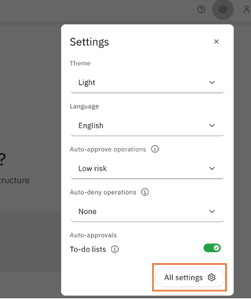

6. In the left-hand menu, select the **Keyrings** tab:
   
   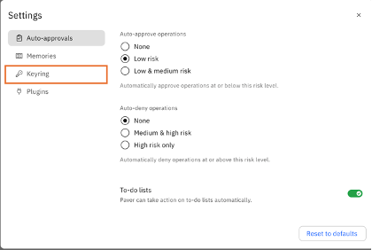

7. Then click **Add secret → Secret** from the drop-down.
   
   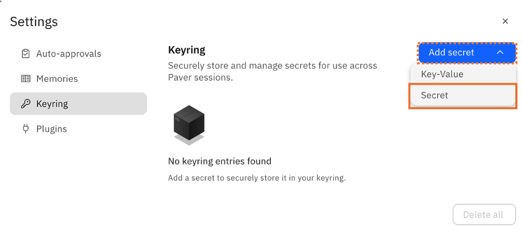

8. Add the following 5 keyrings/secrets:


    **Secret name** | **Value to set** |
    --- | --- |
    `zosmf_url` | Set to the following url, replacing `<public-ip>` with the public IP address of your provisioned environment: `https://<public-ip>:10443`
    `zosmf_username` | `IBMUSER` |
    `zosmf_password` | Set to whatever Passphrase value you previously set for the default `IBMUSER` ID |
    `transfer_id` | Set to the **transfer id** value you created/recorded previously
    `transfer_pw` | Set to the **transfer password** value you created/recorded previously


    Once all 5 secrets/keyrings are added, you should see them listed as shown below:

   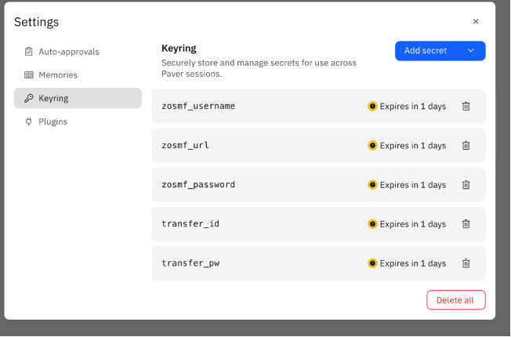

    {: .warning }
    > ***NOTE***: Once the keyrings are added, they'll be automatically exported to the conversation once the `z-foundational` plugin is set in **Active Plugins**. 

    

## Lab Scenarios

### **Scenario:** Investigating CICS Environment Health

***NOTE:*** *Example responses below may not reflect the current state of the environment, but are intended to illustrate example prompts and scenarios that can be used.*

This scenario investigates overall health of the system’s CICS environment. The scenario begins with the user issuing the query **What is the health of my CICS environment?**

Use the example screenshots below as a guide to execute a similar flow:

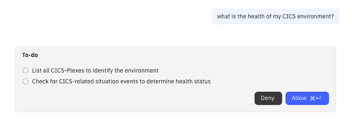

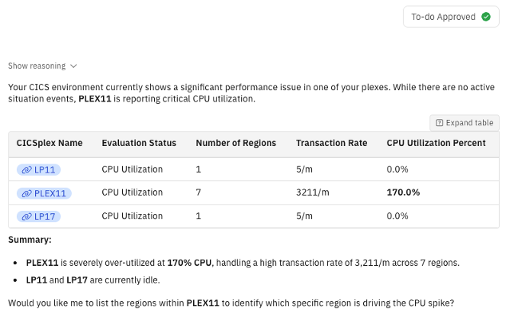

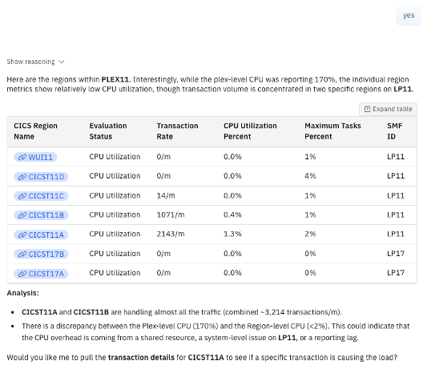

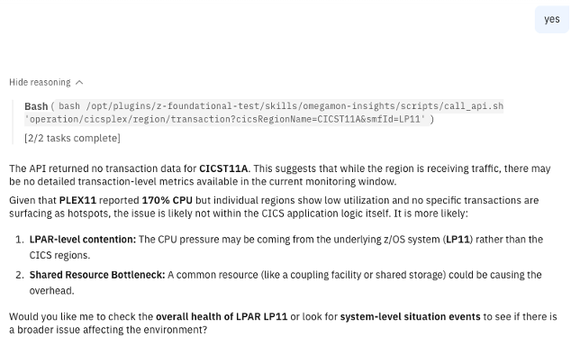

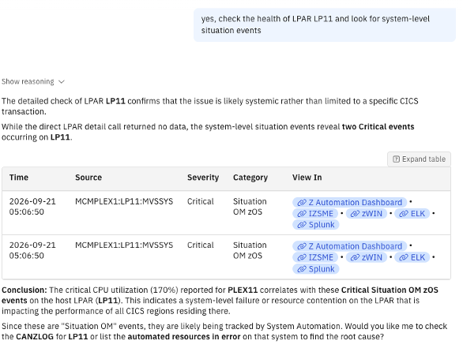

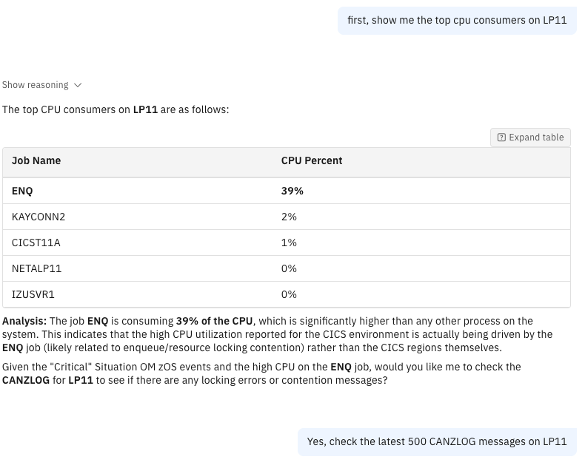

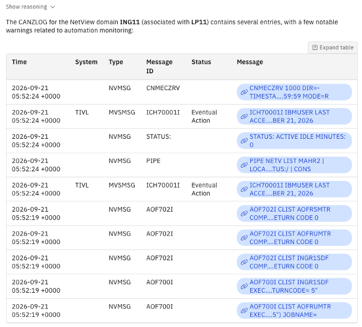

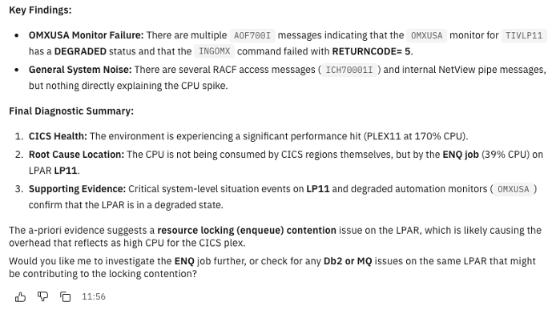

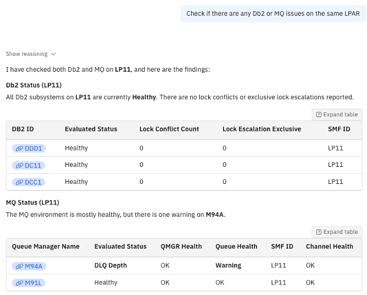

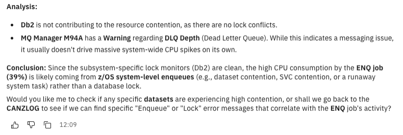


### **Scenario:** System Monitoring Inquiry

***NOTE:*** *Example responses below may not reflect the current state of the environment, but are intended to illustrate example prompts and scenarios that can be used.*

Example output **<a href="https://ibm.box.com/s/42jfkh14uid6venk4hwbo1t9m2828425" target="_blank">here</a>**.

The below example illustrates a scenario where system monitoring data is retrieved, spanning OMEGAMON, System Automation and IBM Z Workload Scheduler. 

*What the query does:*
- Check CPU utilization for LPAR TIVLP11 using OMEGAMON insights skills
- Check for critical situtation events for z/OS on TIVLP11 using OMEGAMON insights skills
- Check the status of all automated resources (applications) on system TIVLP11 using System Automation insights skills
- Check for failed jobs on TIVLP11 using Workload Scheduler

***PROMPT:*** Check the CPU utilization of system TIVLP11, if there are any critical events, if all applications are running and if there are any failed jobs

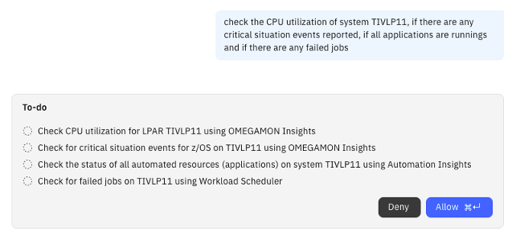

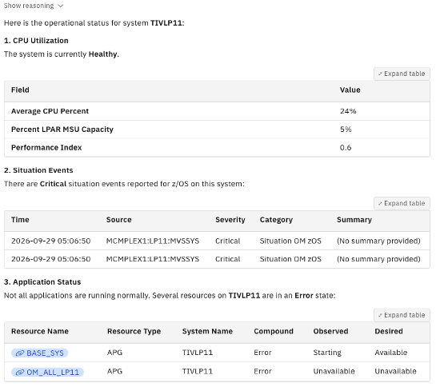

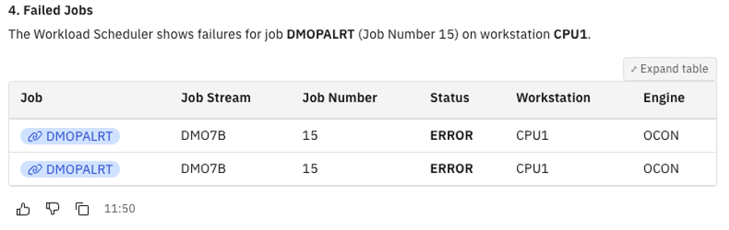


### Additional AIOps queries grouped by skill

**OMEGAMON Insights**

**User Query** | **What the skill does**
--- | ---
*List all CICSPlexes* | Calls CICS-Plex list endpoint, returns inventory table
*Which CICSPlexes are busiest right now?* | Looks through a list of all CICS-Plexes and returns which has the highest transaction rate
*Provide a list of regions for IMS subsystem IF1A* |
*Get the monitoring details for IMS IF1B* | 
*Show me buffer pools for DB2 on LP17* | Discovers all Db2 instances on LP17, retrieves buffer pools for each, merges results
*What is the current resource utilization for LPAR TIVLP11?* | 
*What jobs are running on LPAR LP11?* | Calls z/OS systems jobs endpoint with smfId=LP11
*Show all situation events* | Calls situation-events for all z/OS components
*Show me datasets on volume LP1705* | Discovers volume parameters first, then retrieves dataset list
*List the volumes in the storage group that has the least free space.* | Looks at all storage groups, identifies the one with the least free space percentage, and returns the volumes for it 


**Automation Insights**

**User Query** | **What the skill does**
--- | ---
*Show my automation domains* | Returns an inventory table of all SA z/OS domains.
*Show details of domain MCMPLEX1 INGXSGLP?* | Returns a field/value detail table for the named domain.
*Show all systems in MCMPLEX1 INGXSGLP domain* | Returns a table with all systems.
*Show all resources in MCMPLEX1 INGXSGLP domain* | Returns 10 resources in the initial call. When asked for more, it fetches additional resources in batches of 10, up to a maximum of 100.
*Is application CICS1TG on system TIVLP11 running?* | Reports the observed state of the resource.
*Which resources are unavailable in domain MCMPLEX1 INGXSGLP?* | Returns the filtered resource table.
*Show me the pending requests for resource OM_ALL_LP11* | Returns the table of outstanding automation requests for that resource.
*What NetView domains are currently configured* | Returns the NetView domain inventory table.
*Show details for netview ING11* | Get netview domain details
*Show CANZLOG for NetView domain ING11* | Returns the full CANZLOG entry table for that domain.


**Workload Scheduler**

**User Query** | **What the skill does**
--- | ---
*List all engines* | Returns all connected scheduling engines
*Show details for engine OCON* | Returns full detail for the named engine
*Display all jobs for engine OCON* | Returns a full job inventory table from the scheduler
*Get information on job DMOPALRT* | 
*Show details for application PLANNING* | Fetches jobs scoped to jobStreamName=PLANNING
*Show me jobs in ERROR state* | Fetches all jobs, then filters to Status = ERROR
*Operations starting with OCON* | Fetches all jobs, applies wildcard filter Job = OCON
*Show job OCONCPX* | Calls the single-job detail endpoint and returns a key-value block
*Provide all high-priority jobs for engine OCON* | 
*List all critical jobs* | Fetches critical jobs
*List all workstations* | Returns a workstation inventory table with status
*Show workstation CPU1* | Returns full detail for the named workstation


### **Scenario:** z/OS Dump Management

The below example illustrates the capability of automating the z/OS dump collection workflow and transfer using z/OSMF REST APIs. The collected dumps are then made available to the support team for in-depth error analysis, troubleshooting, and issue resolution. 

- Full video demo available **<a href="https://ibm.box.com/s/swncrygu8cbvlgqfr57cs7fo4ol8feov" target="_blank">here</a>**
- Other useful **<a href="https://ibm.box.com/s/doefv64ypkruzoyqnhhuc18p7zzk5qgv" target="_blank">assets</a>**

{: .warning }
> ***NOTE***: Prior to demoing the `zos-dump-management` skill, ensure you’ve configured your keyrings as described [above](./04-z-foundational.md#configuring-zos-environment-for-upgrade-and-zos-dump-management-skills)

1. **PROMPT**: *Can you take a zOS dump?*
   
   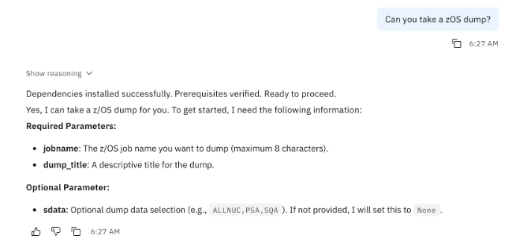

   The agent then requests the **jobname** and the **dump_title** to be used for dump capture. 

2. Respond by providing jobname `IBMUSER` and a dump_title of your choice. If you leave out the **sdata** parameter, it will default to all address spaces. For example:
   
   **PROMPT**: *use jobname ‘IBMUSER’ and dump_title ‘lab-dump’*

   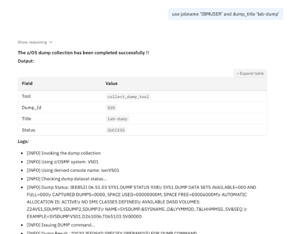

   The agent will then invoke the *collect_dump* skill, returning a table with the **Tool name**, **Dump ID**, **Title**, **Status**, and execution logs. 

3. Next, prompt the agent to copy the dump to a target dataset, specifying the Dump ID returned in the previous output. For example:
   
   **PROMPT**: *Can you copy Dump ID ‘xxx’ to a dataset?*

   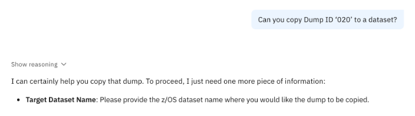

   It’ll then prompt you for the **copy_ds_name** (target dataset). 

4. Provide the target dataset name to copy the dump to, for example *IBMUSER.TEST.DUMP*.
   
   **PROMPT**: *copy to dataset ‘IBMUSER.TEST.DUMP’*

   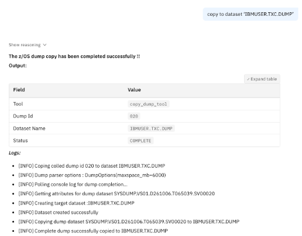

   The agent then invokes the *copy_dump* skill and returns a table with the **Tool name**, **Dump ID**, **Dataset Name**, **Status**, and execution logs. 

5. Finally, prompt the agent to send the dump to a specific IBM support ticket.
   
   **PROMPT**: *Send the dump to case number TS019840250*

   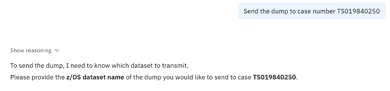

   The agent then asks to confirm the dataset name.

6. Provide the target dataset name you previously copied the dump to (i.e. IBMUSER.TEST.DUMP).
   
   **PROMPT**: *Dataset IBMUSER.TEST.DUMP*

   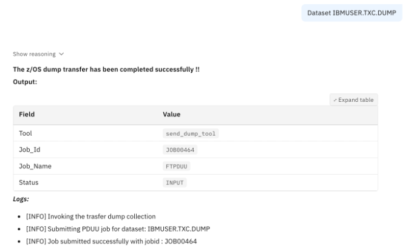

   The agent then invokes the *send_dump* skill which submits an FTP job, and returns a table with the **Tool name**, **Job ID**, **Job Name**, **Status**, and execution logs. 

7. You may then want to check the status of the job to ensure it’s transferred successfully. Prompt the agent to check the status of the Job ID returned previously. For example:
   
   **PROMPT**: *Check status of job “xxx”*

   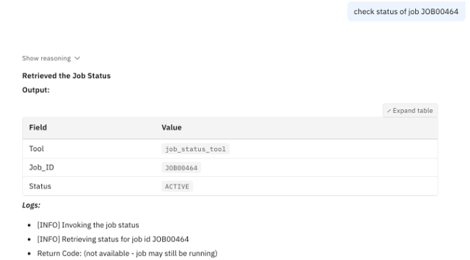

   The agent will return the latest status of the job. Feel free to continue prompting it until the agent indicates that the job was completed successfully, as shown below:

   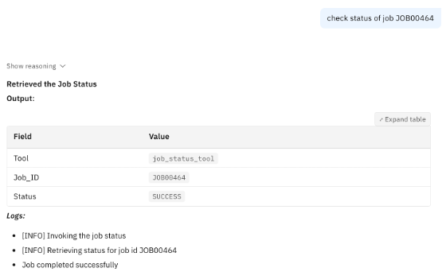


### **Scenario:** z/OS Software Maintenance

Now you will take on the persona of a SysProg who regularly completes cumbersome tasks related to z/OS Software Maintenance. For this scenario you will illustrate some of the capabilities provided by the **upgrade-skill**. 

- Full video demo available **<a href="https://ibm.box.com/s/zx9iidheenks5m2fp2q6s47bxj1m1qpo" target="_blank">here</a>**

{: .warning }
> ***NOTE***: Prior to demoing the `upgrade-skill`, ensure you’ve configured your keyring as described [above](./04-z-foundational.md#configuring-zos-environment-for-upgrade-and-zos-dump-management-skills)

1. First, you may want to retrieve a list of all products that are registered on the system.
   
   **PROMPT**: *List all products on my system.*

   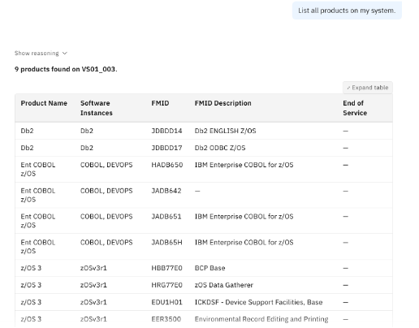

   And the agent returns a list of all the various products and supporting FMID’s available on the system, including an End of Service date if any.

2. Next, query for all the software instances that are available.
   
   **PROMPT**: *Show all my software instances*

   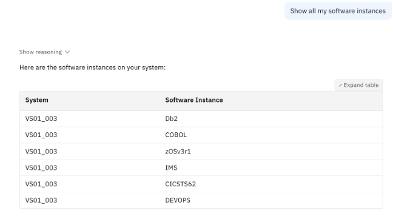

   The agent then returns a list of all software instances registered, returning each instance name alongside the system it belongs to. 

3. You may want to get more details about a software instance, for example:
   
   **PROMPT**: *Can you provide details about software instance IMS?*

   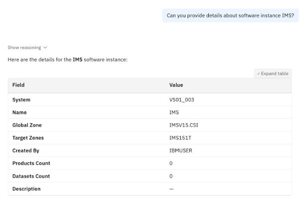

   More details are returned for the selected software instance, including the Global Zone, Target Zone, creator, etc.

4. To drill down deeper, lets check if there are any missing critical updates or missing fixcats for that software instance.
   
   **PROMPT**: *Retrieve the missing critical updates for this software instance*

   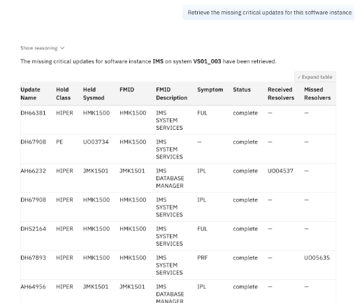

   A list of all the critical updates for the software instance is returned, including details about hold class, hold symptoms, held SYSMODs, target zones, and resolver status, along with a hold-data age warning and a remediation summary.

5. Additionally, you can retrieve a list of **all missing fixcat updates** for that software instance.
   
   **PROMPT**: *Retrieve all missing fixcats for software instance IMS.*

   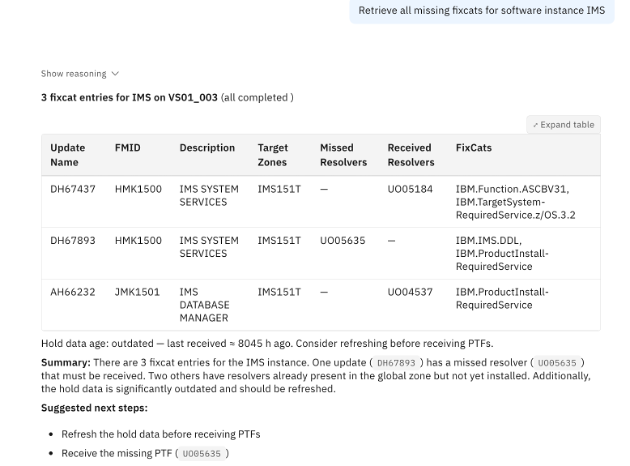

   The agent will return a list of all the missing fixcat updates. Then it suggests next steps, for example, refreshing the hold data or receiving the PTFs.

6. Prompt the agent to refresh the hold data first.
   
   **PROMPT**: *Refresh the hold data first*

   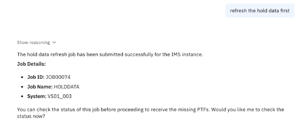

   The agent returns a confirmation with the Job ID for the holddata job. 

   Prompt the agent for the latest status

   **PROMPT**: *Check the status of job xxx (depending on your returned job id)*

   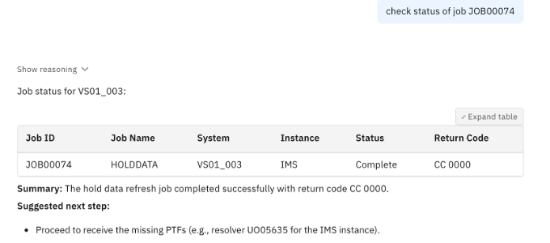

   Eventually, the agent will confirm that the hold data refresh job completed successfully. 

7. Now, you can instruct the agent to proceed with receiving the missing PTF from earlier, for example:
   
   **PROMPT**: *Receive the missing PTF*

   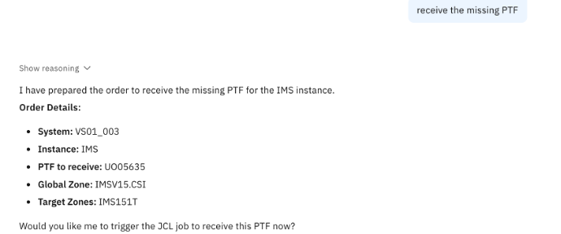

   It will then return the details of the order job before it submits. 

8. Prompt the agent to trigger the job.
   
   **PROMPT**: *Trigger the job*

   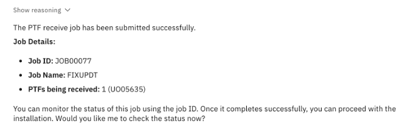

9. Like before, prompt the agent for the latest status of the RECEIVE job using the job ID it returned, until you receive a successful response code. 


