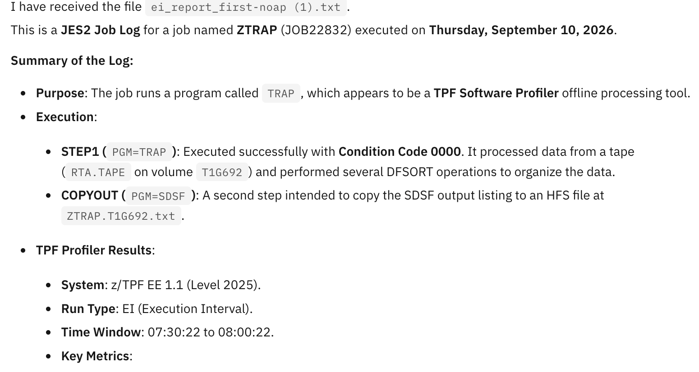
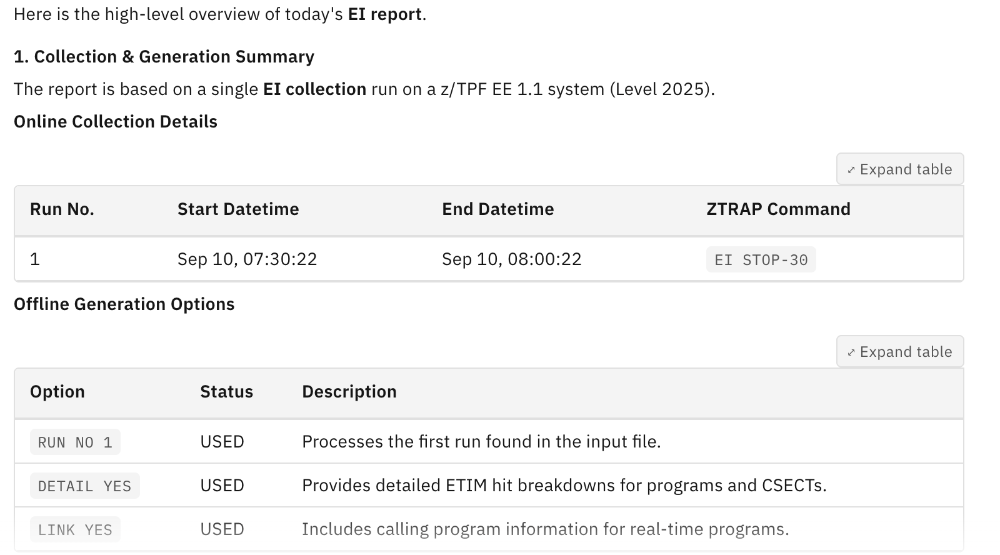
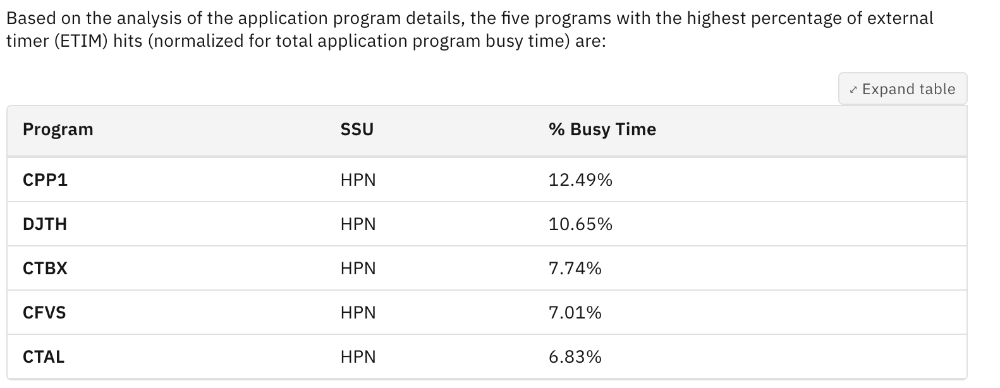
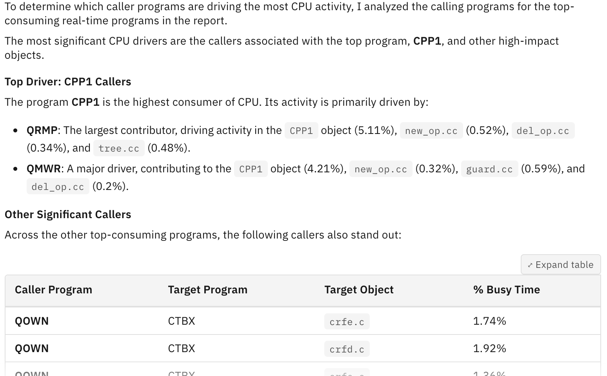

# z/TPF EI Report Analysis​

## Description

Analyze the z/TPF system workload distribution and application activity shown in an uploaded EI report from the z/TPF software profiler.​

**Skill name:** `ztpf-ei-report-analysis​​​`

**Personas:** z/TPF Engineers


Data sources:
- Uploaded z/TPF Report


## Demoing the z/TPF EI Report Skill

**Pre-req:** *Download the sample `ei-report` files <a href="https://ibm.box.com/s/14e2moh7wc4q8xe1mryj66j08jv0ccf8" target="_blank">here</a>*.


1. Navigate to the Chat UI and upload the *ei-report* titled **ei_report_first-noap.txt** that you previously download.

    a. In the Chat box, type `/files upload` then click **Enter**.

   
    b. Select and upload the **ei_report_first-noap.txt** file you previously downloaded.

    After it’s uploaded, Paver may generate a response with an initial analysis:

    


2. To start the skill loading and analysis, invoke the skill manually within the conversation by typing:
   
    ```
    /ztpf-ei-report-analysis Give me a high-level overview of today's z/TPF EI Report.
    ```

    


    After prompted, the skill is loaded and the analysis begins.


    You can then proceed to issue follow-up queries, for example:

    ```
    Which five application programs have the most external timer hits in this report?
    ```
    


    ```
    Which caller programs are driving CPU activity in this EI report?​
    ```
    

    ```
    What percentage of system time is reported as wait time?
    ```

    ```
    Tell me the top 3 differences between today's report and yesterdays' report
    ```
   

