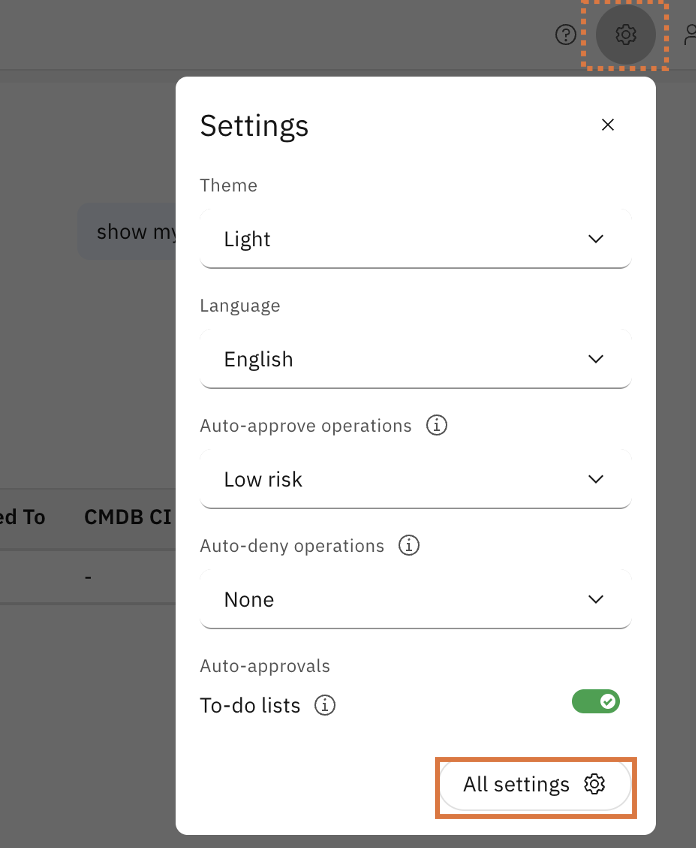
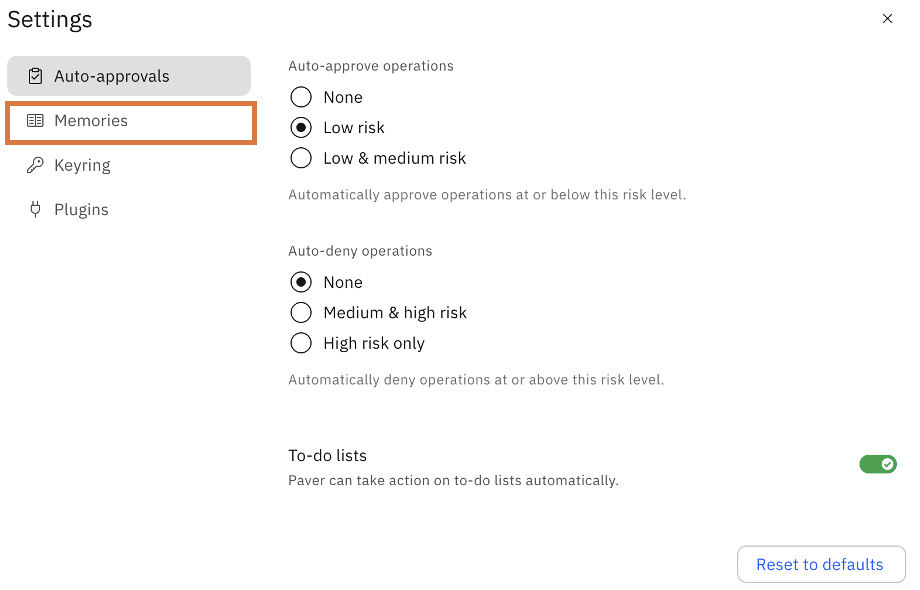
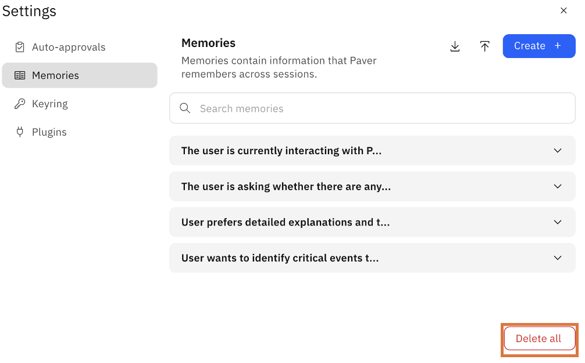
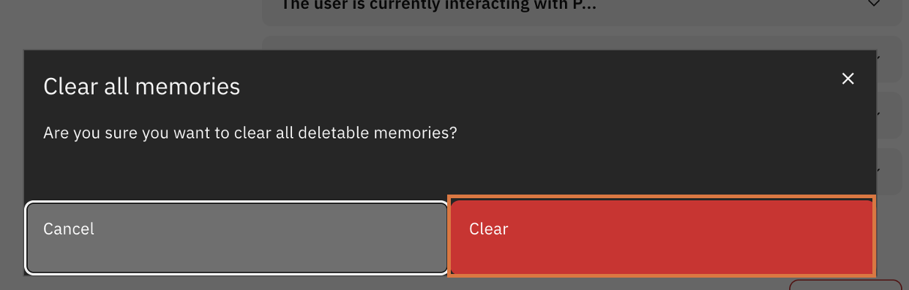
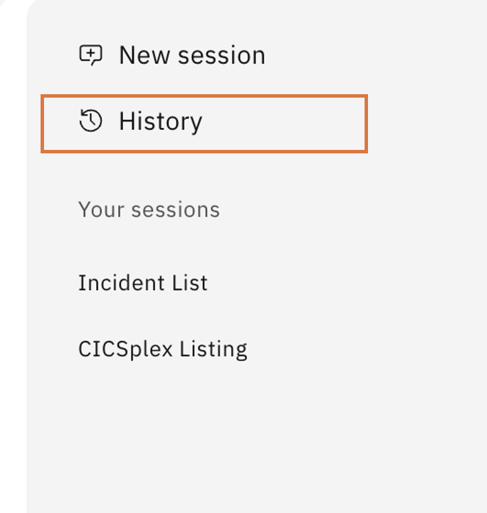
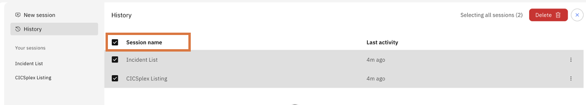
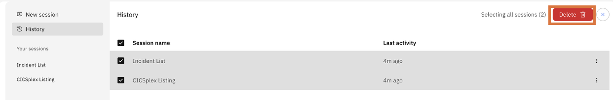
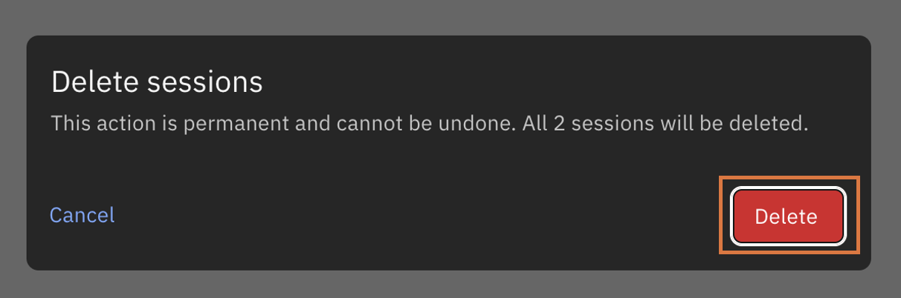

# Best Practices & Troubleshooting

## No response from Paver

If you're running into latency, slow responses, etc. you can troubleshoot with the following steps:

- Make sure you're still authenticated. Log out and log back in. 
- Refresh your browser and start a new conversation

As a last resort, you can try **clearing your memory** and **clearing your conversations**.

### Clearing your memory

1. In the **Chat** tab of the Demo UI, navigate to **All settings**.
   
   

2. Click on the **Memories** tab from the left-hand menu. 
   
   

3. Click **Delete all**. 
   
   

4. Then select **Clear**. 
   
   

### Clearing your conversations

1. In the **Chat** tab of the Demo UI, click on **History** under the **New session** tab.
   
   
   
2. Select all existing conversations.
   
   

3. Click **Delete**.
   
   

4. In the pop-up window, click **Delete**.
   
   

## Issues with `upgrade` and `zos-dump-management` skills

If you face difficulties with the `upgrade` or `zos-dump-management` skills, the first thing to check is that you've configured your `keyrings` correctly. Ensure you follow the steps [here](./04-z-foundational.md#configuring-zos-environment-for-upgrade-and-zos-dump-management-skills) first. 

Once the keyrings are added, they should be automatically exported to the current conversation. 

## Reach out to SME Support slack channel
