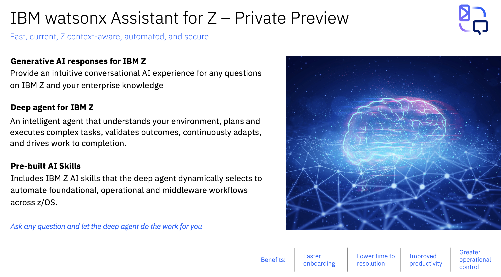

<h1>Introducing skill-based Agentic AI for IBM Z: *Private preview</h1>

Today, we're excited to announce the private preview ahead of the next release of IBM watsonx Assistant for Z which will deliver the capabilities from the recent <strong><a href="https://www.ibm.com/docs/en/announcements/statement-direction-watsonx-assistant-z" target="_blank">Statement of Direction</a></strong>. This next evolution in agentic AI has been redesigned using the <a href="https://agentskills.io/home" target="_blank">Agent Skills standard</a> to deliver a deep agent framework with an extensible toolbox of AI skills.

Since its introduction, watsonx Assistant for Z has helped users quickly access IBM Z and enterprise knowledge, providing live system insights and operational guidance through a conversational experience. As AI continues to rapidly evolve, clients expect more complex operational scenarios demand a deeper level of reasoning and coordination.

By adopting the Agent Skills Standard, IBM watsonx Assistant for Z will deliver a deep agent that goes beyond executing a predefined set of tasks. It can dynamically discover and orchestrate the right skills to understand context, reason across multiple sources of information, investigate issues, develop execution plans, and securely assist users in taking action across their environments with appropriate human oversight. The agent can also evaluate the results of its actions, validate its own work, and adapt its approach when conditions change, enabling users to achieve complex objectives with greater efficiency and confidence.

Through natural language interaction, watsonx Assistant for Z can understand the intent and context behind a request, build and execute a multi-step investigation or remediation plan, gather and synthesize relevant insights from across the environment, and recommend or carry out the most appropriate course of action.

## Help shape what comes next 

The private preview of the next release of IBM watsonx Assistant for Z is an important step toward delivering a deep agentic AI platform for IBM Z. Starting October 1, selected clients and sponsor users will get early access to explore how agentic AI can transform IBM Z experience. Feedback from participating clients will help IBM validate priority scenarios, refine the user experience, explore opportunities for extending skills and guide the capabilities delivered in future releases.

## Key Features on Roadmap for the next release

**Key Updates** | **Value to the customer**
--- | ---
**Next-Generation AI Experience providing a deep agent leveraging the agent skills standard** | More accurate responses and advanced agent capabilities with deep IBM Z expertise that can discover and orchestrate skills, reason across sources, investigate issues, and securely assist with actions.
**Optimized Architecture** | Lower infrastructure requirements, including reduced IFL and memory consumption
**Simplified Deployment** | Automation-based installation with greatly reduced complexity and number of containers that need to be deployed
**Purpose-built inferencing with the most appropriate Large Language Model for each use case** | Enhanced reasoning and Q&A quality through more capable models, enabled by GPU support. Flexible inferencing options include cloud inferencing or inferencing using on-premise GPUs. Both optionally complemented with Spyre on IBM Z.
**z/OS Spyre Agents Skill** | New z/OS Spyre Agents Skill enables immediate value realization of the IBM z17 Spyre technology by providing access to z/OS Spyre Agents that provide Operational Health, Sysplex Exploration and z/OS Configuration Assistance.
**Pre-built skills aligned across an IBM Z Operational Skills Taxonomy** | The IBM Z Skills Taxonomy unifies expertise across 13 operational domains enabling consistent cross-domain reasoning and faster issue resolution through a single AI experience. All pre-built agent capabilities available in v3.3 will be available as pre-built AI Skills aligned to this skills taxonomy.
**Extensible with a user’s own skills** | Simplified approach to creating and adding your skills that provide domain knowledge and custom workflows
**Knowledge Transformer** | Automatically converts unstructured content (e.g., videos or presentations) into AI-consumable knowledge that is optimized for RAG systems

